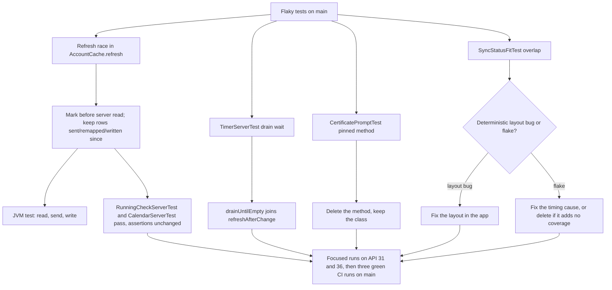
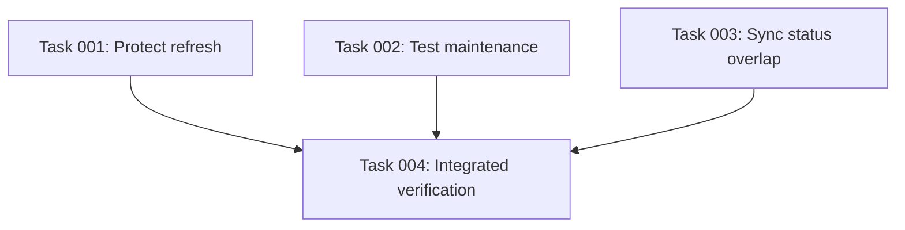

# Plan: Fix or delete the flaky instrumented tests on main

## Original Work Order

> Work order for issue #14 "Triage and fix or delete the flaky instrumented tests on main" (https://github.com/e0ipso/tokkl-android/issues/14).
>
> Objective: make the instrumented-tests job in .github/workflows/ci.yml trustworthy again. Every flaky test gets a recorded verdict (keep and fix, or delete). Kept tests have their root cause fixed in the app or in the test's timing, never by loosening an assertion, adding retries or skipping. The job then passes on three consecutive runs on main, API 36 and API 31.
>
> Scope, in:
> 1. RunningCheckServerTest.startingATimerSchedulesOneCheckAndStoppingItCancelsIt: keep. Cause (confirmed by reading the code): a refresh launched by onSent -> accountSettings.refreshAfterChange() after the first sendAndWait (RunningCheckServerTest.kt:117) reads the server while "Second" still runs. The Stop drain at :123 sends the Stop, and that refresh then writes "Second" back as running. RunningCheck.follow (RunningCheck.kt:55-58, wired at TokklApplication.kt:562) re-enqueues RunningCheckWorker and RunningNotifier reposts the notification, so the :125 assertion fails. This is user-visible: after Stop, the notification, widget and tile can show the timer running again. Fix it in the app (item 4's fix) and keep :125 strict.
> 2. TimerServerTest.startingWhileAnotherEntryRunsLeavesOneRunning: keep. Cause: drainUntilEmpty (TimerServerTest.kt:554-561) ends with accountSettings.refresh().join(). refresh() returns a reconnect refresh that is already running (AccountSettingsSource.kt:78-85) and that read the server before the phone's POST stopped the web timer. Fix in the test: use refreshAfterChange().join(), as commit 4554c8c did for TimerAcceptanceFixture. This also covers the other callers at :217 and :251.
> 3. CertificatePromptTest.pinnedCertificateSignsInWithoutAPrompt (CertificatePromptTest.kt:118-125): delete the method and keep the class. The app made no request in 15 s, so the submit tap probably landed while the keyboard was animating the .imePadding().verticalScroll form (SignInScreen.kt:156-157). That cause is speculative. The behaviour is already covered by CertificatePromptTest.untrustedCertificateShowsItsFingerprintAndSignsInOnceTrusted, api/PinnedCertificateTest.pinnedCertificateReachesTokkl, and the JVM tests PinningTrustManagerTest and SignInModelTest. No kenkeep node or doc names the method; docs/ACCESSIBILITY.md:58 names only the class.
> 4. CalendarServerTest.anUnsentBlockSaysNotSentUntilTheServerHasIt: keep. The issue's description is wrong. CI artifact 12639431001 shows the offline "Not sent" block did appear (:190); the wait at :195 for the sent block timed out, because the row was gone. Cause (confirmed by reading the code): AccountCache.refresh (AccountCache.kt:62-82) reads the server at :69, outside the transaction. It writes after ChangeStore.sent has turned the local row into the server row and dropped its pending change, so the refresh deletes the just-sent entry. User-visible: an entry logged offline can vanish from the List and Calendar after the network returns. App fix: take a mark before the server read and keep rows sent, remapped or written since that mark, following the rule checkedRunning/runningCheckWrites already uses (AccountCache.kt:101-125). Add a JVM test for the order "server read, then send, then refresh write". The same fix covers item 1.
> 5. SyncStatusFitTest.theStatusFitsAboveTheBarAndOpensTheNeedsAttentionList (added at the owner's request): failed on API 31 shard 1 in main run 40348957121 (5b8e906). The "needs attention" label overlaps the Pomodoro item at SyncStatusFitTest.kt:105. Not yet triaged. First decide whether it is a flake or a real layout regression (the latest commits changed brand icons and top bar code), then apply the same keep-fix/delete rules.
>
> Scope, out: other sign-in tests that use the same performScrollTo().performClick() submit pattern (about 10), unless they flake. Changing queue send order. Making Start/Stop wait for the server. The RunningCheck generation guard used at sign-out. Adding a CI retry mechanism.
>
> Context and constraints:
> - Repo rules: tests that only exercise upstream, language or harness behaviour are deleted, not patched (memory: tests-must-test-the-app). When fixing tests, run only the failing methods, never whole classes or the full suite. Conventional Commits with the ticket in a Refs: trailer.
> - Never make Start or Stop wait for the server (.ai/kenkeep/nodes/data-and-offline/practice-never-wait-for-server-on-start-stop.md).
> - Run one instrumented method with scripts/instrumented-tests.sh -Pandroid.testInstrumentationRunnerArguments.class=<fqcn>#<method>, adding TOKKL_TEST_AVD=tokkl-api31 for API 31. Wrap builds and emulators in the OOM-safe systemd-run scope with choom 1000 and .ai/sift/drain/mem-gate.sh (kenkeep testing/instrumented-runner and build-and-tooling nodes). The host has 16 GB and /tmp is tmpfs.
> - CI: job instrumented-tests, matrix API 36 and 31 x 6 shards, no retries, Android Test Orchestrator. Failure details live only in the instrumented-reports-api-<n>-shard-<k> artifacts.
> - After the app fix, update the kenkeep nodes data-and-offline/change-queue/map-ordered-entry-sending-and-refusals.md and map-account-settings-source-and-account-time.md with the new refresh rule.
> - Logcat in CI carries no app log lines, so the order of the races above is inferred from the code and timestamps, not observed.
>
> Success criteria: each of the five tests has its verdict recorded (in the commit messages or the plan). Kept tests pass locally on API 31 and 36 in focused runs. A JVM test proves that a refresh which read the server before a send does not delete or resurrect rows changed by that send. The deleted method is removed. The instrumented-tests job is green on three consecutive main runs on both API levels.

## Plan Clarifications

| Question | Answer |
|---|---|
| Should the plan include SyncStatusFitTest, which failed on the latest main run but isn't one of the issue's four tests? | Yes. Without it, three green runs in a row can't be reached. |
| Is an app-side change to how a refresh treats rows sent during it in scope? | Yes. The issue allows a fix in the app, and test timing can't fix item 4. |
| Is backwards compatibility required for the refresh change? | No. It is internal behaviour with no schema change or public API. |

Checked during planning: the logo commit 9fb98e1 is not an ancestor of 5b8e906, so the SyncStatusFitTest failure on main came before the top-bar logo work on `feat/page-heading-logo`.

## Executive Summary

The issue's four failures have three different causes. Two of them (RunningCheckServerTest, CalendarServerTest) share one real app race. `AccountCache.refresh` reads the server outside its write transaction. If the change queue sends a change between that read and the write, the stale snapshot is written over it. That brings a stopped timer back as running, or deletes an entry the server has just stored. Users see both: the notification, widget and tile show a timer they stopped, or an entry logged offline disappears after the network comes back.

The plan fixes the race once, in `AccountCache.refresh`. It takes a mark before the server read and leaves alone any row the queue sent, remapped or wrote since that mark. `checkedRunning` already uses this rule for the running check, so the refresh adopts an existing pattern rather than inventing one. A JVM test pins the read, then send, then write order. TimerServerTest is a test-timing bug: its final wait joins a refresh that may have read the server too early, and switching to `refreshAfterChange()` fixes it without touching its assertions. CertificatePromptTest's pinned-sign-in method checks nothing that three other tests don't already check, so it is deleted. SyncStatusFitTest is triaged first, then fixed or deleted under the same rules.

The approach keeps every surviving assertion as strict as it is now and adds no retries or skips, so a green instrumented-tests job means the app works again.

## Context

### Current State vs Target State

| Current State | Target State | Why? |
|---|---|---|
| `AccountCache.refresh` writes a server snapshot read before a send, overwriting rows the send changed | The refresh keeps rows sent, remapped or written since a mark taken before its server read | A stopped timer comes back as running, and a just-sent entry vanishes from the List and Calendar |
| After Stop, RunningCheckWorker can be enqueued again and the running notification reposted | Stop leaves no running check scheduled and no running notification once the queue is empty | User-visible stale running state; RunningCheckServerTest:125 fails |
| `TimerServerTest.drainUntilEmpty` joins whatever refresh is running, which may have read before the POST | It joins `refreshAfterChange()`, which reads after the send | The test asserts on a cache that a later refresh would correct |
| `CertificatePromptTest.pinnedCertificateSignsInWithoutAPrompt` flakes and duplicates other coverage | Method deleted; the class and its other methods stay | Repo rule: delete tests that add no coverage of the app |
| SyncStatusFitTest failed on API 31 with an unknown cause | Cause established; test kept and fixed, or deleted | The three-green-runs acceptance criterion can't pass otherwise |
| No test pins the refresh/send ordering | A JVM test covers server read, then send, then refresh write | Instrumented tests only hit the race by chance |

### Background

- The refresh reads the server at `AccountCache.kt:69` and writes in a transaction at `:71-76`. `withPending` overlays only the changes still pending at write time (`CacheContents.kt:68-73`, `PendingChange.kt:133-141`). A change sent between the read and the write has left the queue, so nothing protects its row.
- `AccountCache.refresh` already takes `changes.chainMark()` before the server read for the pause chain (`:64-68`). `checkedRunning`/`runningCheckWrites` (`:101-125`) keep "rows written since `before`". The fix extends that idea to the refresh's entry writes.
- `ChangeSender.drainUntilQuiet` calls `onSent` (`ChangeSender.kt:260`), which launches `accountSettings.refreshAfterChange()` (`TokklApplication.kt:322`) without waiting for it. That refresh corrects the race eventually, but the race window lasts until it lands. If it fails, the error stays until the next refresh event.
- `AccountSettingsSource.refresh()` returns a refresh that is already running (`:78-85`). `refreshAfterChange()` waits for it and starts a new one (`:94-97`). Commit 4554c8c already made this switch in `TimerAcceptanceFixture`.
- The TimerServerTest race (a reconnect refresh writes the web timer as running next to a pending phone Start) is not covered by the app fix. There the refresh writes before the send, and the server's rule that stopping one timer ends the other is not mirrored in `withPending`. The post-send refresh self-corrects it, so it is handled in the test, not the app.
- CertificatePromptTest: logcat shows the app made no request for 15 s, while a sibling test on the same emulator signed in within 2 s. The pin is read from storage on every handshake (`PinningTrustManager.kt:230-245`), so a pin race is ruled out. The likely cause, a tap during the keyboard animation, is speculative. The coverage named in the work order makes the method redundant.
- SyncStatusFitTest is a pure Compose layout test with no network (`SignedInFrame` with a fixed `STATUS`). The failure on API 31 shard 1 at 5b8e906 says the "needs attention" label overlaps the Pomodoro bar item. Earlier main runs (for example 40287959415 at b58fa73) passed. Whether this is size- or font-dependent and deterministic, or intermittent, is not yet known.
- CI logcat has no app log lines, so the race orderings above come from reading the code and timestamps, not from observing them.

## Architectural Approach

### Refresh keeps rows changed during its server read
**Objective**: Stop a stale server snapshot from overwriting rows the change queue sent while the refresh was reading, so a stopped timer stays stopped and a just-sent entry stays in the cache.

Before the server read, `AccountCache.refresh` records a mark that identifies which rows the queue sends, remaps (negative local ID to server ID) or writes from then on. When it writes the snapshot, rows changed since that mark keep their cached state. Rows still pending are protected by `withPending` as they are now. Every other row takes the server's state as it does today. The mark and the "changed since" check follow the existing `chainMark`/`runningCheckWrites` precedent rather than a new mechanism; the task-generation step decides the exact store, for example a sequence or timestamp the change DAO already keeps, after reading `ChangeDao`, `ChangeStore.sent` and `runningCheckWrites`.

Constraints: Start and Stop must not wait for the server. Queue send order stays as it is. The refresh stays non-blocking for the queue. The RunningCheck sign-out generation guard is untouched. No Room schema change is expected. If the mark needs a new column, stop and confirm with the owner first, because that brings a migration.

A JVM test drives the ordering directly: the refresh reads a snapshot, the queue then sends a Start, a Stop or a new entry, and the refresh then writes. The test asserts the sent row is neither deleted nor brought back to its pre-send state. RunningCheckServerTest (`:125` strict) and CalendarServerTest (`:195`) then pass with their assertions unchanged.

### TimerServerTest waits for a refresh that read after the send
**Objective**: Make the test's final cache read reflect the server state after the phone's POST.

`drainUntilEmpty` joins `accountSettings.refreshAfterChange()` instead of `refresh()`, as `TimerAcceptanceFixture` already does. The one-running-entry assertion stays as it is. The other callers of `drainUntilEmpty` (around `:217` and `:251`) get the same guarantee.

### Delete the redundant pinned-sign-in test
**Objective**: Remove a flaky method whose behaviour other tests already cover.

Delete `CertificatePromptTest.pinnedCertificateSignsInWithoutAPrompt` and any helper or import only it uses. The class and its other methods stay. No kenkeep node or doc names the method; confirm with a grep before closing.

### Triage and resolve SyncStatusFitTest
**Objective**: Establish whether the API 31 overlap is a real layout regression or a flake, and resolve it under the keep-fix/delete rules.

Pull the `instrumented-reports-api-31-shard-1` artifact from run 40348957121 for the exact bounds. Check whether earlier and later main runs on API 31 pass this test at the same commit range, and run the method on the local API 31 AVD several times. A deterministic overlap is an app layout bug and is fixed in the layout code, with the test kept as is. An intermittent one needs its timing cause found and fixed in the test or the app. If it turns out to check nothing the app needs, it is deleted. The guarded behaviour, a sync status that fits above the bar without covering a bar item, is user-visible, so delete is the least likely outcome.

### Verdict record
**Objective**: Leave a durable per-test verdict as the issue requires.

Each test's commit message states the verdict (keep and fix in app, keep and fix in test, or delete) and the cause. The issue (#14) is not closed or edited by this plan.

## Risk Considerations and Mitigation Strategies

Technical Risks

- **The "changed since mark" rule keeps a row the server has since changed elsewhere**: a row sent during the read keeps its local state even if the web edited it afterwards.
    - **Mitigation**: The `onSent` → `refreshAfterChange` refresh reads after the send and still runs, so the next refresh corrects it. Cover this in the JVM test: a later refresh with no intervening send takes the server's state.
- **Remapped IDs**: a local negative-ID row becomes a server-ID row during the read; the snapshot has neither or the server ID.
    - **Mitigation**: The JVM test includes the remap case (the new entry from item 4) as well as Start and Stop.
- **The fix needs a schema change**: the mark might need storage the change DAO doesn't keep.
    - **Mitigation**: Prefer existing sequences, as `chainMark` does. If a migration turns out necessary, stop and confirm with the owner.
- **SyncStatusFitTest is a real regression on main**: the fix may touch the shared signed-in frame.
    - **Mitigation**: Check screenshot tests on both API levels after the layout change. The existing screenshot assets are a baseline.

Implementation Risks

- **Local runs don't reproduce the CI races**: the races depend on emulator timing.
    - **Mitigation**: The JVM test is the proof for the app fix. Focused instrumented runs check nothing regressed, and three CI runs on main are the acceptance gate.
- **Host memory**: emulators and Gradle can trigger OOM kills that end the agent session.
    - **Mitigation**: Run every build and emulator under the systemd-run scope with choom 1000 and `.ai/sift/drain/mem-gate.sh`. Run only the affected methods, one AVD at a time.
- **Another unrelated flake turns CI red during the three-run gate**.
    - **Mitigation**: Treat any new failure as out of scope. Report it to the owner with its artifact instead of widening the plan without asking.

## Success Criteria

### Primary Success Criteria
1. Each of the five tests has a verdict and cause recorded in its commit message: RunningCheckServerTest, TimerServerTest and CalendarServerTest kept and fixed; CertificatePromptTest's pinned method deleted; SyncStatusFitTest resolved by its triage outcome.
2. A JVM test shows that a refresh whose server read came before a send neither deletes nor brings back rows that send changed, covering Start, Stop and a new entry with a remapped ID. It fails on the code before the fix.
3. No surviving assertion is loosened. Nothing is retried, skipped, `@Ignore`d or `@FlakyTest`-annotated. RunningCheckServerTest:125 still checks once with no wait.
4. The kept instrumented methods pass in focused runs on the local API 31 and API 36 AVDs.
5. After merge, the instrumented-tests job passes on three consecutive runs on main, on API 36 and API 31.

## Self Validation

1. Run the new JVM test and the existing JVM tests for `AccountCache`, `ChangeSender`, `RunningCheck` and `CacheContents` with Gradle's `--tests` filter, under the memory gate and OOM-safe scope. Confirm they pass.
2. Temporarily revert only the `AccountCache.refresh` change (`git stash` of that file), run the new JVM test, and confirm it fails. Then restore the change.
3. With `scripts/instrumented-tests.sh -Pandroid.testInstrumentationRunnerArguments.class=<fqcn>#<method>`, run each kept method once on `TOKKL_TEST_AVD=tokkl-api31` and once on the API 36 AVD: RunningCheckServerTest#startingATimerSchedulesOneCheckAndStoppingItCancelsIt, TimerServerTest#startingWhileAnotherEntryRunsLeavesOneRunning, CalendarServerTest#anUnsentBlockSaysNotSentUntilTheServerHasIt, and SyncStatusFitTest#theStatusFitsAboveTheBarAndOpensTheNeedsAttentionList if kept. Record pass/fail from the runner output.
4. Run `grep -rn pinnedCertificateSignsInWithoutAPrompt` across the repo. Confirm there are no matches outside git history.
5. Run `git diff` on every changed test file and confirm no assertion message, timeout, condition or expected value was weakened, and no retry, skip or ignore annotation was added.
6. If SyncStatusFitTest's fix touched layout code, run the affected screenshot test methods on both AVDs and look at the produced images for the sync status above the bar.
7. After the owner merges and pushes, list main runs with `gh run list --workflow ci.yml --branch main` and confirm three consecutive successful runs. For any failure, download the matching `instrumented-reports-api-<n>-shard-<k>` artifact and report the failing test.

## Documentation

- Update `.ai/kenkeep/nodes/data-and-offline/change-queue/map-ordered-entry-sending-and-refusals.md` and `.ai/kenkeep/nodes/data-and-offline/map-account-settings-source-and-account-time.md` with the new refresh rule: rows sent, remapped or written since the mark taken before the server read stay as they are.
- If SyncStatusFitTest leads to a layout change, update the kenkeep node under `design/` or `screens/` that describes the sync status line, if one exists.
- No README, AGENTS.md, CLAUDE.md or `docs/` change is required: no feature, command or user-facing text changes. Confirm `docs/ACCESSIBILITY.md:58` still describes CertificatePromptTest correctly after the method is deleted.
- Run `npx kenkeep index rebuild` after editing nodes.

## Resource Requirements

### Development Skills
- Kotlin, Room transactions and coroutines (refresh/send concurrency).
- WorkManager scheduling semantics as used by `RunningCheck.follow`.
- Jetpack Compose UI testing and layout bounds (SyncStatusFitTest).

### Technical Infrastructure
- Local AVDs `tokkl-api31` and the default API 36 AVD, and the tokkl test server used by the server-backed instrumented tests.
- `scripts/instrumented-tests.sh`, `.ai/sift/drain/mem-gate.sh`, systemd-run user scope with choom.
- `gh` (project token through the wrapper) for CI runs and artifacts.

## Integration Strategy

The app fix stays inside `AccountCache.refresh` and whatever change-DAO query provides the mark. Callers (`AccountSettingsSource`, `ChangeSender.onSent`, `ForegroundRefresh`) keep their signatures and call order. Test changes stay inside the affected test files.

## Notes

- Commits follow Conventional Commits with `Refs:` trailers; issue #14 is referenced, not closed.
- The current working tree on `feat/page-heading-logo` holds unrelated uncommitted top-bar logo and screenshot work. Implement this plan on a branch from `origin/main`, not on top of that work.

## Execution Blueprint

**Validation Gates:**
- Reference: `/config/hooks/POST_PHASE.md`
- Method-only tests; one AVD at a time; matching passing evidence is reusable.
- Main acceptance remains pending until the owner merges and three consecutive main instrumented jobs pass.

### Dependency Diagram

### Phase 1: Fix the refresh race and affected tests
**Status:** halted at task003 infrastructure failure; cache fix verified, Android-test compilation and lint passed, API 31 emulator crashed before test execution
**Parallel Tasks:**
- Task 001: Protect refresh from concurrent entry writes.
- Task 002: Correct the test refresh wait and remove duplicate coverage.
- Task 003: Triage and resolve sync status overlap.

### Phase 2: Verify focused methods and acceptance gates
**Status:** pending
**Parallel Tasks:**
- Task 004: Verify kept methods and acceptance gates, depends on 001, 002, 003.

### Post-phase Actions

Verify scoped evidence before committing each phase. Run POST_EXECUTION and the single code review gate only after validation is green. Keep the plan active when the post-merge main gate is pending.

### Execution Summary
- Total Phases: 2
- Total Tasks: 4
- Coverage: task 001 owns refresh/send ordering, deterministic JVM evidence and refresh documentation; task 002 owns the helper wait and duplicate deletion; task 003 owns overlap triage and correction; task 004 owns integrated focused verification and acceptance evidence.
- Dependency graph is acyclic. Every task occurs once; all phase 1 tasks have no dependencies.

## Execution Summary

**Status**: Halted, phase 1 incomplete
**Completed Date**: Not completed; execution stopped on 2026-10-26
**Code Review**: Failed: Review was not run; phase 1 blocked by memory admission (exit 75).

### Results

Generated four routed tasks and a two-phase blueprint. Created `feature/1--fix-or-delete-flaky-instrumented-tests` from current `origin/main`, base `afbb3bb8026b1b44faff80bfe12d9245a9cd3c1d`.

Task 002 completed its scoped source edits and static checks. `TimerServerTest.drainUntilEmpty` joins `refreshAfterChange()` after queue delivery, preserving assertions. Removed only the redundant pinned-sign-in method from `CertificatePromptTest`; its class and other tests remain, and the accessibility matrix still names the class correctly. The source diff has one changed helper line and nine deleted method lines. No production source is changed. Changes are uncommitted because the phase verification gate did not pass.

Task 001 is failed due to memory admission, with an uncompiled regression draft preserved in `evidence/task-001-refresh-regression-draft.patch`. No expected RED assertion was observed, no production fix was applied, and no GREEN claim is made. Its draft and notes cover the before-read cached-row/pending-ID mark, Start/remap, Stop, removal and a later uncontended refresh.

Task 003 confirmed the API 31 overlap from CI artifacts and a prior pass with unchanged sync-status source. Exact runtime cause remains unverified. Cross-layout bounds sampling is a hypothesis requiring a focused device run, not an established root cause. No layout or test-timing correction was applied. Task 004 has not been dispatched because phase 1 is incomplete.

Per-test verdicts:
- RunningCheckServerTest: keep and fix in app; stale refresh can resurrect a stopped row. Fix and verification pending.
- CalendarServerTest: keep and fix in app; stale refresh can drop a sent/remapped row. Fix and verification pending.
- TimerServerTest: keep and fix in test; helper now waits for a refresh begun after sending. Runtime verification pending.
- CertificatePromptTest redundant pinned-sign-in method: delete because surviving app, API and JVM coverage already guards pinning. Deleted; speculative IME-tap explanation is not claimed as proven.
- SyncStatusFitTest: retain while investigating its intermittent overlap; final fix/root-cause verdict pending runtime evidence.

### Noteworthy Events

- The memory-safe scoped RED command is recorded in task 001. It requested only `CacheContentsTest.aRefreshReadBefore*`, waited at the admission gate for 30 seconds, and exited 75. Gradle never started; exactly zero tests ran. Final app.slice headroom was 2,403,246,080 bytes below memory.high and 4,550,729,728 bytes below memory.max, both below the 5000 MiB JVM requirement. Durable raw diagnostics: `evidence/task-001-memory-admission.log`.
- A separate read-only device-capacity probe was denied at the 8192 MiB requirement. No emulator was started. There were no repeated test runs, whole-class instrumented runs, full suites or new CI dispatches.
- Applied POST_ERROR_DETECTION and halted phase 1. The user chose: "Finish available work and report the blocked checks". No further verification workloads were attempted after that direction.
- Fresh coordinator review of the scoped diff confirmed no surviving assertion, timeout, expected value or condition was weakened; no retries, ignores or skips were added. `git diff --check` passed. Removed-method search has no matches in app/src or docs; plan/evidence intentionally retain its name for the audit trail.
- Review gate JSON: not produced. Review was not run because phase 1 and POST_EXECUTION are not green. No review findings were acted on or ignored; no certified review exists.
- No phase commit, push, merge, issue write, kenkeep update, archival or claim of passing tests occurred.

### Necessary follow-ups

1. Restore sufficient host/cgroup capacity for the mandatory gate, then explicitly resume failed tasks. Apply the draft regression, obtain a real failing assertion, implement atomic before-read mark and merge protection without schema changes, and run only the focused regression and related JVM filters.
2. Reproduce the exact SyncStatusFitTest method on API 31, establish the timing or layout cause, and fix it without weakening assertions or adding retries/skips. Use the retained CI evidence as the starting point.
3. Update the named kenkeep refresh nodes after the production fix and rebuild the index. Complete phase 1 evidence and its conventional commit before dispatching task 004.
4. Run only the kept methods on API 31 and 36, one AVD at a time. If layout changes, select only the affected screenshot methods and respect the API 36 reference restriction. Run required lint and static audits. Reuse matching passing evidence rather than repeat expensive checks.
5. After owner merge/push, confirm three consecutive green main instrumented-tests jobs on both API levels. Current main runs cannot validate these unmerged changes. Only after all gates pass, run POST_EXECUTION and the code review gate once, record its exact outcome and archive the completed plan.

## Resumed execution, 2026-10-26

The owner requested: "Resolve the current block and continue. Whats the blocker?"
A fresh probe confirmed the app.slice admission limit was the remaining constraint despite about 9.6 GiB available host memory. Its existing limits are memory.high 10 GiB, memory.max 12 GiB and swap.max 2 GiB. The app.slice memory.stat showed substantial reclaimable file cache. Two bounded `memory.reclaim` requests with `2G swappiness=0` returned success, reclaiming approximately 2.40 and 2.46 billion bytes respectively. No memory limit, admission floor or process was changed. A fresh scoped JVM probe then admitted 5000 MiB with no blockers, at app.slice memory.current 4,665,815,040 bytes. Device admission still requires 8192 MiB and is not yet claimed to pass.

Phase 1 resumes with task001 and task003 on their resolved implementer routes. Task002's existing source changes remain. The earlier Halted summary is a historical checkpoint, not the current execution outcome. Gradle and device jobs remain serialized, method-filtered, OOM-scoped and memory-gated.

### Resumption verification checkpoint

Task001 implemented the atomic before-read entry/pending-ID mark and write-time protection. The regression RED ran three selected tests and failed all three for the intended stale-refresh assertions. The focused GREEN ran 92 tests: CacheContentsTest 16, ChangeSenderTest 64, RunningCheckTest 12, all with zero failures/errors/skips. No green test rerun was needed. JUnit evidence and verified-source hashes are retained under evidence/task-001-resume-*.

Task003 implemented same-frame bounds capture in the existing overlap assertion helper. It resolves interactions before runOnIdle, then reads all live node coordinates within one main-thread task. All existing comparisons and assertions remain unchanged. The prior CI failure is its RED evidence; runtime cause is not claimed proven. Compilation and exact-method GREEN are pending.

The coordinator ran `npx --no kenkeep index rebuild`, exit 0, regenerating 16 indexes and GRAPH.md from 89 nodes. A combined `compileDebugAndroidTestKotlin` plus `lintDebug` workload, max-workers=2, has twice been refused by memory admission before Gradle started. Logs: build/plan-1-evidence/phase1-compile-lint.log and phase1-compile-lint-retry.log. Neither is a compile or lint result.

After cache reclamation could no longer admit the 8192 MiB device budget, the coordinator temporarily changed runtime app.slice memory.high to 11776 MiB, retaining the existing 12 GiB hard limit and raising the host admission floor to 8192 MiB. A 20-minute systemd fallback restore timer was armed first. The probe still denied admission. The coordinator immediately restored memory.high to 10 GiB and stopped the fallback timer; memory.max remains 12 GiB. No test ran under the temporary threshold.

A fresh process/control-group inspection identified concurrent Branch Truce drain work, including a C++ build in `truce-0173-highlighter-attached`, alongside six Branch Truce Claude agents. At that snapshot the agent group accounted for about 4.3 GiB, Docker 2.3 GiB and T3 0.8 GiB, including cache and tmpfs charges. Both Android AVDs remain stopped; no emulator has run in this execution. User asked whether the competitor was another emulator; clarified that it is shared host work, then identified these sources on request.

Model provenance: task001 resolver selected gpt-6-astra/high from complex-architecture. Tasks002/003 resolver selected gpt-5.6-sol/high from standard-implementation's Codex target in local config.yaml. The user challenged use of 5.6; no further worker has been dispatched since that question.

## Execution Summary, resumed attempt

**Status**: Halted at remaining phase-1 verification
**Completed Date**: Not completed; checkpoint 2026-10-26
**Code Review**: Failed: Review was not run; remaining phase-1 verification is blocked by shared-host memory admission.

### Results

Task001 is completed and independently checked by the coordinator against fresh JUnit XML, full build logs and `sha256sum --check` of the verified sources. Three regression tests failed for the expected assertions before the fix; all 92 selected JVM tests passed after it, zero failures/errors/skips. Saved the verified cache fix and kenkeep changes in local commit `95a6122` (`fix: preserve entry writes during stale refreshes`, Refs: #14). This is an intermediate commit; the phase is not marked complete.

Task002's test-helper correction and redundant certificate-method deletion remain uncommitted and statically checked. Task003's same-frame bounds correction remains uncommitted, with every assertion preserved. Task003 is in-progress because compilation and exact-method GREEN have not run. Task004 remains pending its dependencies. No full suite or emulator test ran.

### Noteworthy Events

- Cache reclamation admitted real JVM runs and resolved the original inability to test task001. No expensive passing test was repeated. Later concurrent jobs refilled shared memory and cache. Combined Android-test compilation and lint admission expired with exit 75 twice, before Gradle started, despite bounded cache reclamation. These are pending checks, not compiler or lint failures.
- Both AVDs were confirmed stopped by device_list. A process/control-group scan identified six active Claude agents in branch-truce, including a C++ build under `/home/e0ipso/.cache/branch-truce-drain/drain/truce-0173-highlighter-attached/build/desktop`. Other charges include Docker and the T3 service; the broader agent group snapshot was about 4.3 GiB, Docker 2.3 GiB and T3 0.8 GiB. The user asked for the offender and was given these measured sources.
- The user questioned use of Sol 5.6. Explained that the exact blueprint resolver selected `gpt-5.6-sol`/high from standard-implementation's local Codex target; task001 used `gpt-6-astra`/high. No new worker was dispatched after that question.
- Runtime app.slice memory.high is restored to 10 GiB, memory.max remains 12 GiB, and the temporary restoration timer was stopped. No other agent or container was stopped, no unrelated temporary artifacts were deleted, and no remote changes were made.
- Review gate JSON: not produced. POST_EXECUTION is not green, so the code review gate has not run; no findings were accepted or ignored and no review certification exists.

### Necessary follow-ups

1. Resolve competing shared-host resource use, starting with the identified Branch Truce drain. Recheck both host and all ancestor-cgroup capacity before the next workload; do not infer admission merely from free host RAM.
2. Run the pending combined `:app:compileDebugAndroidTestKotlin :app:lintDebug` command through the memory gate with `--no-daemon --max-workers=2`. No JVM test rerun is required if its recorded source fingerprints still match.
3. Run only `SyncStatusFitTest#theStatusFitsAboveTheBarAndOpensTheNeedsAttentionList` on API 31 to establish GREEN, then close phase 1 and create its remaining conventional commit after evidence review.
4. Dispatch task004 and run only the kept methods on API 31 and 36, serialized and with matching passing evidence reused. No app layout was changed, so screenshot reruns are currently unnecessary.
5. After owner merge/push, confirm the three consecutive green main instrumented jobs required by the plan, complete POST_EXECUTION, run the review gate exactly once, record its exact JSON/codeReview and archive only when all gates pass.

### Owner-authorized constrained attempt

Owner explicitly instructed "Try anyways" after the fresh admission refusal. This overrides the local admission preflight requirement for the attempted checks. The coordinator launched the pending compile/lint command without mem-gate, retaining systemd OOM isolation and choom 1000, reducing Gradle to one worker and `-Xmx1g -XX:MaxMetaspaceSize=512m`, and adding a per-job MemoryHigh=2560M, MemoryMax=3G and MemorySwapMax=0. Shared app.slice limits remain at the original 10 GiB high / 12 GiB max. No other agent or container was stopped. Log: build/plan-1-evidence/override-compile-lint.log. The tool host reset while waiting, so the coordinator reattached by checking the existing process and log rather than launching a duplicate build. Android-test Kotlin compilation reached completion and subsequent lint tasks began; final build/lint outcome is still pending at this checkpoint.

## Execution Summary, owner-authorized attempt

**Status**: Halted at task003 device infrastructure failure
**Completed Date**: Not completed; checkpoint 2026-10-27
**Code Review**: Failed: Review was not run; API 31 emulator crashed before task003 verification could execute.

### Results

The owner explicitly instructed "Try anyways" despite memory admission refusal. The constrained compile/lint attempt passed: BUILD SUCCESSFUL in 6m 14s, instrumented Kotlin sources compiled and lint reported zero Error/Fatal issues. It used one Gradle worker, a 1 GiB heap, 512 MiB metaspace and a 3 GiB per-job hard cap while retaining OOM isolation, choom 1000 and the original shared app.slice limits. Tool-host restarts interrupted monitoring; the coordinator recovered the existing process/log and did not start a duplicate build.

One exact-method API 31 attempt then booted the emulator and packaged the APKs, but QEMU hung and exited 139 before instrumentation. Gradle failed connectedDebugAndroidTest with No connected devices!, BUILD FAILED in 6m 33s. Exactly zero device tests ran. Task003 is failed, task004 is undispatched, and no phase is marked complete. The three layout/data assertions in the JVM regression previously failed before the app fix and all 92 selected JVM tests passed after it; that passing evidence remains valid for unchanged production sources.

### Noteworthy Events

- Parent independently inspected final compile/lint output and parsed lint-results-debug.xml, finding zero errors/fatal and nine total issues. The original shell exit status was lost in the tool-host restart and is not fabricated. Retained evidence: evidence/override-compile-lint.log, override-lint-results-debug.xml and override-verified-test-sources.sha256.
- Device infrastructure evidence: evidence/api31-sync-status-failure.log. The runner reports hung QEMU threads, emulator exit 139, full memory pressure avg10=38.04, host 7199 MB available and swap 253 MB free. This is an execution failure, not an assertion result. No full suite, method retry or second AVD was started.
- Cleanup verified: tokkl-plan1-api31.scope and tokkl-emulator-5554-6022e5a6.scope inactive; no test fixture containers or slot locks remain; owned runner directory removed. Read-only emulator writes were discarded. No unrelated process, container or temporary artifact was removed.
- Applied POST_ERROR_DETECTION and halted phase 1. The specific geometric race remains a hypothesis addressed by consistent same-frame sampling; runtime GREEN is not claimed.
- Review gate JSON: not produced. POST_EXECUTION is not green, so the code review gate has not run. No findings were accepted or ignored; no certification exists.

### Necessary follow-ups

1. On owner direction, retry only the same API 31 method using the now-built APKs, preferably after competing host work subsides. Keep one job and the small JVM configuration; do not rerun compilation/lint or the 92 green JVM tests without changed inputs.
2. After task003 GREEN, complete phase 1 and its remaining conventional commit; run task004's exact kept methods on API 31/36, reusing matching evidence.
3. After owner merge/push, establish three green main instrumented jobs as required by the plan. Then complete POST_EXECUTION, run the review gate once and archive only when all gates pass.

### Saved checkpoint and requested direction

Saved the compiled/linted test-maintenance changes in local commit `207bc9e` (`test: capture consistent refresh and layout state`, Refs: #14). The existing verified app fix remains in `95a6122`. The coordinator checked source hashes and git diff --check before committing. No source changes remain unstaged; the active plan folder is still untracked and remains in plans/ for continued execution. Phase 1 remains incomplete because no device method executed.

Requested owner direction after the failed emulator attempt: retry the exact single API 31 method once using the now-built APKs, or leave device verification pending. Reusing those APKs would avoid the packaging work that overlapped the first emulator run, but does not prove the host has adequate capacity. No new run is authorized by elapsed time alone.

## Owner decision, 2026-10-27

The owner chose "Leave device verification pending" after the API 31 infrastructure failure. Do not automatically retry or start another device run. Keep the plan in plans/ and retain the existing task003 failure history with its device verification deferred; task004 remains pending. Compilation/lint and the 92 passing focused JVM tests remain verified for the recorded source fingerprints. Local implementation commits are 95a6122 and 207bc9e. No push, merge, PR creation, review certification or archival is authorized by this checkpoint.

## Execution Summary, deferred device verification

**Status**: Halted; device verification deferred at owner request
**Completed Date**: Not completed; checkpoint 2026-10-27
**Code Review**: Failed: Review was not run; device verification is pending at owner request after the API 31 emulator crash.

### Results

Saved the cache race fix in 95a6122 and test maintenance in 207bc9e. Three targeted JVM regression tests failed as expected before the fix; all 92 selected JVM tests passed afterward. Instrumented-test compilation and lint passed, with zero Error/Fatal lint findings. The API 31 attempt crashed before running a test, so there is no device GREEN evidence. Phase 1 remains incomplete, task004 has not been dispatched and the plan remains active.

### Noteworthy Events

The owner explicitly declined another device attempt and selected deferred verification. Existing failure logs, source hashes, lint output and JVM JUnit results remain in evidence/. Review gate JSON: not produced because POST_EXECUTION is not green. No findings were acted on or ignored; no certified review exists. No tests, builds or emulator jobs were started for this decision update.

### Necessary follow-ups

Resume device verification only when requested by the owner. Then verify the exact kept methods on API 31 and 36 using existing built APKs and matching passing evidence where applicable, complete phase gates, confirm the required three post-merge main runs, run the review gate once and archive only after all required gates pass.

## PR creation and merge authorization, 2026-10-27

Owner instructed "Create a PR, merge on green." This explicitly authorizes pushing this branch, creating the PR and merging after fresh CI/readiness checks. It supersedes the earlier checkpoint's lack of authorization for those actions. Local device verification remains deferred.

Pushed feature/1--fix-or-delete-flaky-instrumented-tests at 207bc9e8b46dd1cdeb162b96558409f185c32b06. Created https://github.com/e0ipso/tokkl-android/pull/17 against main and linked it to this T3 thread. Before publication, the coordinator checked both source fingerprints, JVM JUnit totals, compile/lint logs and zero Error/Fatal lint count; no expensive passing check was repeated. Current origin/main remains afbb3bb and no merge conflict is present. The PR description explicitly records the local emulator failure and pending device validation.

CI run 40461438428 is queued/running for the PR, including all API31/API36 shards. Repository auto-merge is disabled, so use T3's watcher and merge only after a fresh readiness read confirms green checks and no unresolved blockers. Do not fabricate a green run or enable a retry mechanism. The plan's three consecutive post-merge main runs remain a separate acceptance gate; do not trigger repeated full CI runs merely to manufacture that evidence.

### PR watch recovery, 2026-10-27

T3 reported that its PR watcher stopped after eight host-read failures. Direct gh checks succeeded: PR17 remains OPEN and MERGEABLE at head207bc9e8b46dd1cdeb162b96558409f185c32b06, with no unresolved review threads returned. CI40461438428 has successful gradle, reproducible-release and commitlint jobs; all twelve API31/API36 instrumented shards remain in progress. No failure or conflict currently requires a code change, and no rerun was triggered. Re-registering T3 watch; merge authorization remains conditional on fresh green readiness checks.

### Second PR watch recovery, 2026-10-27

T3 again reported eight host-read failures. Direct gh inspection succeeded for PR17 at unchanged head207bc9e8b46dd1cdeb162b96558409f185c32b06: OPEN, MERGEABLE, no unresolved review threads returned. All six API31 shards and API36 shards0-4 passed, alongside gradle, reproducible-release and commitlint. Only API36 shard5 remains in progress, so merge-on-green is not yet satisfied. No source change or CI rerun is warranted. Re-enable the native watch as requested; direct CLI access works while the watcher has twice failed to read host state.

## PR merged after green CI, 2026-10-27

The third watcher-stopped notification triggered a fresh direct gh readiness check. PR17 was OPEN, CLEAN and MERGEABLE at unchanged tested head207bc9e8b46dd1cdeb162b96558409f185c32b06, with no unresolved review threads. All twelve instrumented shards (six API31 and six API36) and gradle, reproducible-release and commitlint had SUCCESS conclusions. Release-only PR jobs were SKIPPED as expected. The coordinator updated the PR validation notes and squash-merged with --match-head-commit to enforce the tested head, following the owner's standing "merge on green" authorization.

Fresh gh verification confirmed PR17 state MERGED, mergedAt2026-10-27T07:18:10Z, squash commit9d5ccb4d6018c73b84c2a9f69a2af867b18a1aaf. PR URL: https://github.com/e0ipso/tokkl-android/pull/17. The watcher was explicitly disabled after merge; the PR remains linked to this thread. No additional CI run or local device retry was triggered. Local plan files remain active, and the separate requirement for three consecutive successful post-merge main runs has not been proven, so no blueprint archival or clean code-review certification is claimed.
