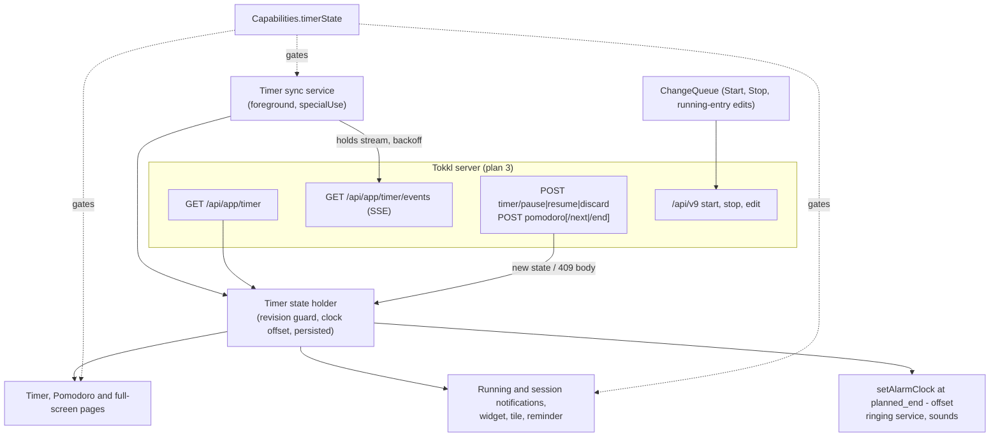
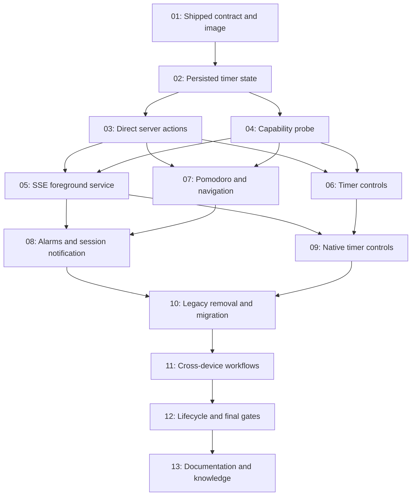

# Plan: Server-owned Pomodoro sessions and pause chain on Android

## Original Work Order

> Move Pomodoro sessions and the timer's pause chain from the device to the Tokkl server, so a session or pause started on any device (KDE, GNOME, macOS, web) shows and can be controlled on the phone, and the reverse. The server contract is tokkl plan 3, "Server-owned timer state with cross-device sync" (`../tokkl/.ai/strikethroo/plans/03--server-owned-timer-state-and-cross-device-sync/`), and the API table in `../tokkl/docs/PRD.md` once it ships. `GET /api/app/timer` returns the state: `revision`, `server_time`, the running entry, `pause`, and `pomodoro` with the planned end, upcoming phase, transition and pomodoro number. The actions are `POST /api/app/timer/{pause,resume,discard}` and `POST /api/app/pomodoro[/next|/end]`; `next`, `end`, `resume` and `discard` send the last seen revision and get 409 when it is stale. Actions need a connection. No offline queue. Every signed-in device rings at a phase end, so the phone must learn about sessions started elsewhere while it is in the background, and a confirm on another device must silence its alarm. The server offers SSE but no FCM, and the app ships on F-Droid. Decide with me how the phone learns about remote changes (for example an SSE stream held by the ringing or session foreground service, polling, or UnifiedPush). Remove the Room session row, the local phase rules port, the pomodoro save path through ChangeQueue, the foreign-entry handoff, and the local pause chain. Keep AlarmManager alarms scheduled from the server's planned end corrected by `server_time`, the ringing service, sounds and notifications. Backwards compatibility with device-local sessions is not required.
>
> Follow-up from the owner during planning: make sure to align with the ../tokkl plan for Pomodoro syncing.

## Plan Clarifications

| Question | Answer |
| --- | --- |
| Toggl Track and Tokkl releases before plan 3 have no `/api/app/timer`. What do Pomodoro and Pause do there? | Hide both. A new capability, probed with `GET /api/app/timer`, gates them. Without it the Pomodoro destination and every Pause and Resume control are hidden. Start and Stop keep working through v9 and the queue. All device-local session and chain code is deleted. |
| How does the phone learn about remote changes while in the background? | An always-on SSE service. While signed in to a server with the capability, a foreground service of type `specialUse` on its own silent channel holds `GET /api/app/timer/events` and reconnects with backoff. The owner accepts the permanent notification and the radio wakeups from the server's 25 s keep-alive, and the PRD's battery rules are rewritten to match. |
| Is backwards compatibility with device-local sessions required? | No (work order). The Room session and chain rows are dropped by a migration, and nothing carries over. |
| Server plan 3 has no endpoint for changing a paused chain's fields. What happens to Android's edit-while-paused (PRD T1, full-screen timer)? | Drop it, as on the server and the web. While paused, the chain's fields show read-only, Edit is hidden, and Resume starts the fields recorded at Pause. |
| Scope approval: capability gate; always-on SSE service with backoff, started at app open, boot and app update; one state holder corrected by `server_time` driving every surface; session and pause actions sent directly, never queued; 409 adopts the body's state; offline actions fail with a message on every surface; plain Start and Stop keep the queue; alarms, ringing service, sounds, full-screen alarm, session notification, per-session lengths and the four defaults kept; Room tables, `time/Pomodoro.kt`, the pomodoro queue path, the foreign-entry handoff and the local chain deleted; tests of removed parts deleted; image pin moved to the release with plan 3; docs and kenkeep updated. | Approved as stated. |
| Where does issue #14's fifth flaky test belong while Pause moves to the server? | Source: user direction, 2026-10-28. [Task 06](tasks/06--move-timer-controls-to-server-pause-state.md) owns the keep-and-rewrite verdict for [the reported inherited focused-timer test](https://github.com/e0ipso/tokkl-android/issues/14#issuecomment-6419333769), the refresh race diagnosis, settled direct-Pause coverage and focused checks on both APIs. Do not reopen Plan 01 for an interim local-Pause drain fix. Its issue #14 closure gate still requires three consecutive successful main CI runs covering API 36 and API 31. |

## Executive Summary

Android runs its own copy of the Pomodoro rules today. `time/Pomodoro.kt` ports `pomodoroSession.ts` from tokkl `bed61cb`. The session sits in a Room row next to the change queue, and each pomodoro is snapped and posted as a queued stopped entry. The phone ends its session when it sees a timer that another client started. The pause chain is another Room row with its own chain id, revision and epoch fencing. No other device can see either one, and the phone learns of remote changes only on app open, network return, the tile refresh and a 15 minute check while a timer runs.

Tokkl plan 3 moves both onto the server. It keeps one timer state per user, applies every rule, derives the planned end, transition, upcoming phase and pomodoro number, and pushes the full state over SSE on every change, including changes made through `/api/v9`. This plan turns the phone into a client of that state, in the same way plan 3 turns the web and desktop into clients. A foreground service holds the SSE stream whenever the account's server offers the timer API. Each state it receives updates one state holder, which drives the screens, the notifications, the widget, the tile and the exact alarms. Session and pause actions are online POSTs that carry the last revision seen, as plan 3 specifies.

The phone keeps what only a device can do. It counts down on a server-corrected clock, schedules `setAlarmClock` at the server's planned end, rings with the existing service and sounds, shows the full-screen alarm and the session notification, and keeps the start form with its per-session lengths and the four defaults. A session or pause started on KDE, GNOME, macOS or the web shows on the phone within seconds and can be controlled there, and the reverse holds. A confirm on any device silences the phone's alarm.

## Context

### Current State vs Target State

| Current State | Target State | Why? |
| --- | --- | --- |
| The session lives in the Room row `pomodoro_session` (`cache/PomodoroSession.kt`, `PomodoroSessionDao.kt`), written in the same transaction as the queued entry. | The session is `pomodoro` in the server's `TimerState`. The phone keeps the last state it received and no session row. | A session started on another device must show on the phone. |
| Phase changes, the long-rest count, the planned end and the transition come from `time/Pomodoro.kt`, a port of `pomodoroSession.ts` checked against a copied `pomodoroSession.json`. | `phase.planned_end`, `transition`, `upcoming_phase` and `number` come from the server. The phone subtracts the corrected current time and does nothing else. | Plan 3 makes the fixtures a server-side contract. A client that reads the state needs no port. |
| Each pomodoro is snapped on the phone and posted as a stopped entry through `ChangeQueue`. | The open pomodoro is the server's running entry. The server stops and snaps it on rest-to-work, End session or any other stop. | Plan 3 has one write path, and the queue, snap and handoff code leaves every client. |
| The phone ends its session at a foreign timer's start when it sees one (`AccountCache` handoff, `timerHandoffCommitted`). | Any start of another entry stops the pomodoro entry on the server, which ends the session there. The phone sees the state change. | The rule holds whichever client starts the timer. |
| The pause chain is the Room row `pause_chain`, plus `TimerSession`, `ChainMark` and chain id, revision and epoch fencing in `TimerControls`, the widget, the tile and the notification. | The chain is `pause` in the state (`paused`, `seconds`, the entry fields, `clone_entry_id`). Pause, Resume and Discard are server actions. | A pause on KDE must show as paused on the phone with the same total. |
| Edits while paused change what Resume starts. | While paused, the fields are read-only and Edit is hidden. Resume starts the fields recorded at Pause. | Plan 3 has no endpoint for paused fields, and the web drops the same feature. |
| Pause, Resume and Stop-while-paused work offline from the app, notification, widget, tile and reminder. | They need the server. Offline they fail with "Can't reach the server. Try again when you're back online." and the shown state stays. Plain Start and Stop of a running entry keep the offline queue. | Plan 3 makes these actions online-only to remove the offline session queue. |
| No push reaches the phone. It refreshes on app open, network return, the tile's shade refresh and a 15 minute check while a timer runs. | A foreground service holds `GET /api/app/timer/events` whenever signed in to a server with the timer API, and reconnects with backoff. | Every signed-in device rings at a phase end, so a session started elsewhere must reach an idle phone before its first phase ends. |
| Pomodoro and Pause are shown on Tokkl and Toggl Track alike. | Both are hidden unless the new timer state capability is true. | Toggl Track and older Tokkl have no timer API, and the local fallback is deleted. |
| Instrumented tests run against `ghcr.io/e0ipso/tokkl:1.8.1`, pinned by digest in `scripts/instrumented-tests.sh`. | They run against the first tokkl release that ships plan 3, pinned by digest. | Real-server tests must exercise the timer API. |

### Background

Facts read in both trees on 2026-10-27:

- **Server contract (tokkl plan 3, tasks 01 to 03; all pending on 2026-10-27).**
  - `TimerState` (snake_case):
    - `revision` (integer) and `server_time` (ISO 8601 with milliseconds);
    - `running_entry`: the v9 shape with meta, or null;
    - `pause`: non-null for the whole life of a chain, with `paused` (true when no clone runs), `seconds`, `workspace_id`, `description`, `project_id`, `task_id`, `tag_ids`, `tags`, `billable` and `clone_entry_id`;
    - `pomodoro`: null without a session, otherwise `work_minutes`, `short_rest_minutes`, `long_rest_minutes`, `long_rest_every`, `phase` (`kind`, `start`, `completed`, `planned_end`), `upcoming_phase`, `transition`, `number`, `entry_id` and `pomodoro_start`;
    - `discarded_pomodoro`: `{ entry_id, start, stop }` when the change that produced this revision discarded a too-short pomodoro, otherwise null.
  - Endpoints, all behind `requireAuth`, so Basic auth with an API token or a password works:
    - `GET /api/app/timer`;
    - `POST /api/app/timer/pause` (no revision);
    - `POST /api/app/timer/resume` and `POST /api/app/timer/discard` (with `revision`);
    - `POST /api/app/pomodoro` (start: optional `workspace_id`, `description`, `project_id`, `task_id`, `tag_ids` or `tags`, `billable`, `created_with`, and overrides for the four lengths);
    - `POST /api/app/pomodoro/next` and `POST /api/app/pomodoro/end` (with `revision`).
  - Every action returns the new state. Every refusal, stale revision or not, is 409 with the current state as the body. A non-integer revision is 400.
  - Pause is refused during a session or when nothing runs. Start session is refused while a session exists, ends any chain and stops the running entry at the session start.
  - `GET /api/app/timer/events` sends `event: timer` with one line of JSON on connect and on every change, and a `: keep-alive` comment every 25 s. It caps streams at 10 per user and closes the oldest. It closes a stream whose credential stops passing `stillSignedIn`.
  - Stopping the clone or the pomodoro entry through v9 ends the chain or the session on the server. Editing the open pomodoro's description, project, task, tags or billable is a normal v9 edit of the running entry, and the server copies those fields into the next pomodoro.
  - Plan 3 says old Android builds keep working: they see the pomodoro entry as a foreign timer.
- **Web behaviour this plan matches (plan 3 tasks 04 to 06).**
  - It drops a state with a lower revision than the cached one.
  - It keeps a clock offset `server_time - now` taken when each state arrives.
  - Error texts: "Another device changed the timer first." for 409 and "Can't reach the server. Try again when you're back online." for no network.
  - The alarm rings when corrected now reaches `phase.planned_end`, picks the sound from `transition` and is keyed by `phase.start`. It stops when a state arrives with a different `phase.start` or no `pomodoro`.
  - It says "This pomodoro was too short to save." for a `discarded_pomodoro` it has not shown.
  - It shows "Pomodoro N of M" as `number` of `long_rest_every`.
  - It edits the open pomodoro with a v9 update of `pomodoro.entry_id`, and fills the paused view from `pause`.
  - The elapsed time while a clone runs is `pause.seconds` plus the clone's time since its start.
  - A Stop while a clone runs stays a v9 stop.
- **Android today.**
  - The session row is `cache/PomodoroSession.kt` and `PomodoroSessionDao.kt`. The chain and timer session rows are in `cache/PauseChain.kt`.
  - The rules port is `time/Pomodoro.kt`, tested by `app/src/test/java/.../time/PomodoroTest.kt` with `app/src/test/resources/time/pomodoroSession.json`.
  - The handoff is in `cache/AccountCache.kt` and `cache/ChangeQueue.kt` (`timerHandoffCommitted`).
  - Chain and session fencing runs through `cache/TimerControls.kt`, `ChangeStore.kt`, `ChangeDao.kt`, `widget/WidgetActions.kt` and the `pomodoro/` session store, screen, alarm, notification and ringing models.
  - `CacheDatabase` is at version 8 with exported schemas.
  - `Capabilities` (`capabilities/Capabilities.kt`) holds Tokkl-only flags, probed at refresh and cleared at sign-out.
  - Auth is an OkHttp `Authorization: Basic` header (`api/ApiCredentials.kt`). OkHttp is 5.5.0, with no SSE module.
  - The only foreground service is the `mediaPlayback` Pomodoro ringing service. A receiver already handles `BOOT_COMPLETED` and `MY_PACKAGE_REPLACED` for alarm re-arming.
- **PRD today.** W10 ("The session lives on the device only") and W12 (syncing out of scope) are reversed by this plan. Sections 6.3 and 7 promise no wakeups while no timer runs, and the owner accepted changing that.

### Server release status

Task 01 checked this on 2026-10-28. No published Tokkl release contains plan 3, so the release gate stays closed and tasks 02 to 13 must not start.

- `ghcr.io/e0ipso/tokkl:1.9.0` exists, with index digest `sha256:ce7e9f18a6541e5264cb4c4509f35d0dbe4543cccafaf740f2f61b2642f75252` for linux/amd64 and linux/arm64. The `1.9` and `latest` tags point at the same index, and 1.9.0 is the newest version tag in the registry.
- Tag `v1.9.0` is commit `61e08ad` ("chore(release): 1.9.0"), which is also `main` on GitHub. Its changelog entry lists only tokkl plan 2, the desktop Pomodoro mode from PR #46. The image has no revision label, so the source revision comes from the tag.
- The `v1.9.0` tree has no `packages/api/src/services/timerState.ts`. `git grep` finds no `/api/app/timer`, `/api/app/pomodoro` or `TimerState` under `packages/` or `docs/`.
- A container started from that digest, with a fresh account and Basic auth, answers 200 to `GET /api/v9/me` and `GET /api/app/bounds`. It answers 404 `"Not found"` to `GET /api/app/timer`, `GET /api/app/timer/events`, `POST /api/app/timer/pause` and `POST /api/app/pomodoro`.
- Plan 3 lives on the branch `feature/3--server-owned-timer-state-and-cross-device-sync`, open and unmerged as e0ipso/tokkl#48 at `c6a0902`. Four fixes landed after the archive commit `abbbf1b`. One of them changes the API (`6e2c59d`, "move the timer revision when a name it shows changes"), so the contract can still change before a release. At `c6a0902` git no longer tracks the plan 3 archive. Read it at `abbbf1b`, or in the sibling's working tree.
- The blueprint's earlier claim that 1.9.0 is the first candidate came from the top entry of the sibling's changelog, and it was wrong.

Still to do once a release contains plan 3: reconcile this plan with its API table, `TimerState` types, routes and SSE behaviour, move `IMAGE` in `scripts/instrumented-tests.sh` (still Tokkl 1.8.1), check the Stop assertions against that release, and run the focused device check. Re-run task 01 then. Confirm the release tag sits on a commit that contains plan 3 before taking its index digest.

## Architectural Approach

### Capability gate

**Objective**: Hide Pomodoro and Pause where the server cannot own them, and nowhere else.

Add a `timerState` flag to `Capabilities`, decided at refresh by `GET /api/app/timer` in the way `probeTrash` decides the trash. A parsed `TimerState` means present. A 404 or a body that is not a timer state means absent. No clear answer keeps the previous value. The flag is false on Toggl Track and on Tokkl releases before plan 3, and sign-out forgets it like the other flags. Without it:

- the Pomodoro destination leaves the bar, the rail and the alarm entry points;
- Pause and Resume leave the Timer page, the full-screen timer, the running notification, the widget, the tile's controls and the reminder;
- the sync service does not run.

Start, Stop and editing the running entry stay as they are.

### Timer state model and holder

**Objective**: One place on the phone that knows the server's timer state and the clock offset.

- **Model.** Kotlin serializable types mirror `TimerState` field for field, with the v9 running entry reusing the existing time entry model.
- **Holder.** An account-scoped holder keeps the latest state, its arrival instant and the offset `server_time - now`. It drops a state whose `revision` is lower than the one it holds.
- **Persistence.** It persists the latest state with the account's other stores. After process death the alarm receivers, the notification and the widget then act on the last known state without a request. Sign-out clears it.
- **Running entry.** Each state's `running_entry` also updates the cached current entry, so the Timer page, the totals and the running notification follow remote starts and stops without a separate refresh. The existing reconciliation with queued local changes stays in charge of conflicts.
- **Derived values.** Remaining time, overtime, "Pomodoro N of M", the paused total, and the clone's elapsed time (`pause.seconds` plus time since the clone's start) are computed from the held state and the corrected clock. No phase rule runs on the phone.

### Timer sync service

**Objective**: Get every remote change to the phone within seconds, including when it is idle in the background.

- **Lifecycle.** A foreground service of type `specialUse`, with the `PROPERTY_SPECIAL_USE_FGS_SUBTYPE` property in the manifest, runs while the account is signed in and `timerState` is true. It posts a silent, low-importance notification on its own channel. It starts on app open, after sign-in and from the existing `BOOT_COMPLETED` and `MY_PACKAGE_REPLACED` receiver. It stops at sign-out and when the capability goes false.
- **Stream.** It holds `GET /api/app/timer/events` on the shared OkHttp client, with the pinning trust manager and the account's `Authorization` header and no read timeout, and parses `event: timer` blocks by hand. Each block's single `data:` line is one JSON state, and comment lines are ignored. Hand parsing avoids a new dependency.
- **Reconnects.** A watchdog treats about 60 s without data or keep-alive as a dead stream. Reconnects use exponential backoff with a cap. Network-return events reconnect at once.
- **Auth failures.** A 401 or 403 stops the service and shows the existing re-sign-in path. Retrying cannot fix it.
- **Offline.** While the stream is down, the holder keeps the last state. The countdown and the scheduled alarm keep working from it, as plan 3 requires.

### Server actions

**Objective**: Pause, Resume, Discard, start session, Next phase and End session go to the server and never through the queue.

- **Requests.** A small client sends each POST with a JSON body. `revision` comes from the holder for next, end, resume and discard. Start session sends the form's fields, the four per-session lengths and `created_with` as the app sets it for timers.
- **Answers.**
  - A 2xx state goes into the holder.
  - A 409 puts the body's state into the holder and reports "Another device changed the timer first."
  - No network reports "Can't reach the server. Try again when you're back online."
  - Other failures follow the app's existing error handling.
- **Surfaces.** The app, the running and session notification actions, the widget, the tile's controls, the alarm screen and the reminder's Pause all use this client. A notification or widget action that fails offline leaves the shown state unchanged and tells the user, through the same failure path each surface already uses.
- **Restrictions.**
  - Pause is hidden while `pomodoro` is non-null, because the server refuses it during a session.
  - Edit is hidden while `pause.paused` is true. The paused view shows the fields from `pause`.
  - Stop while a clone runs is a normal queued v9 stop, and the server ends the chain.
  - Editing the open pomodoro's fields on the Pomodoro page is a normal edit of the running entry (`pomodoro.entry_id`) through the existing path.
- **Too-short pomodoros.** A `discarded_pomodoro` the phone has not shown yet produces "This pomodoro was too short to save." once, keyed by its `entry_id`.

### Alarms, ringing and notifications on the server state

**Objective**: Every signed-in phone rings at the server's planned end, and stops when any device confirms.

- **Scheduling.** The phase alarm is scheduled with `setAlarmClock` at `phase.planned_end` minus the clock offset, keyed by `phase.start`. It is re-armed from the held state after reboot, app update, clock or timezone change and an exact-alarm grant, as today. A missed end rings immediately.
- **Silencing.** A state with a different `phase.start`, or with no `pomodoro`, cancels the alarm, stops the ringing service and closes the full-screen alarm, whichever device caused the change.
- **Content.** The transition sound comes from `transition`. The session notification and the alarm screen show phase, countdown or overtime, "Pomodoro N of M" and the upcoming phase from the state. Their Next phase and End session buttons call the server actions.
- **Kept as they are.** Permissions, channels, the full-screen alarm, the sounds, vibration and the ringing service.

### Removal of device-local session and chain code

**Objective**: Leave one code path, the server's.

- Delete `time/Pomodoro.kt`, `PomodoroTest.kt` and the copied `pomodoroSession.json`.
- Delete `cache/PomodoroSession.kt`, `PomodoroSessionDao.kt` and the pomodoro save path through `ChangeQueue` and `ChangeStore`.
- Delete the foreign-entry handoff in `AccountCache` and `ChangeQueue`.
- Delete `PauseChain`, `ChainMark`, `TimerSession` and the chain id, revision and epoch fencing in `TimerControls`, the widget, the tile and the notification. A surface's action now carries the server `revision` it was shown at.
- Remove the session-ending step from sign-out.
- A Room migration from version 8 drops `pomodoro_session`, `pause_chain` and `timer_session` without carrying data, and the exported schema is updated. Queued v9 changes already in the queue still send.
- Before deleting each module, list its callers in the live tree, and keep or move what other features still use, such as `time/Snap.kt` for timer stops. Delete tests that cover only removed behaviour, and rewrite tests whose behaviour moves to the server state. Tests of upstream or harness behaviour are not added.

### Test server and real-server tests

**Objective**: Prove the phone against the real server contract.

- Move `IMAGE` in `scripts/instrumented-tests.sh` to the first tokkl release that ships plan 3, pinned by digest. Check the stop-rule assertions named in the kenkeep node "Test against a real Tokkl server" against that release.
- Add instrumented tests against that server for:
  - a session started through the API from another credential showing on the phone with the server's phase and number;
  - Next phase from the API silencing a ringing phone;
  - a stale Next phase from the phone getting 409 and showing the server state;
  - pause and resume across the API and the phone, with the same total;
  - offline actions failing with the message and leaving state unchanged;
  - Pomodoro and Pause hidden when the capability is false.
- Update the screenshot references that change, on tokkl-api36, in the commit that changes the look.

## Risk Considerations and Mitigation Strategies

Technical Risks

- **Server plan 3 not shipped**: The contract exists only as a plan. Field names or behaviour may change during its execution.
    - **Mitigation**: Execution starts only after a tokkl release with plan 3 is published to `ghcr.io/e0ipso/tokkl`. The first task reads the API table in `../tokkl/docs/PRD.md` and the shipped `TimerState` type, and updates this plan where they differ.
- **Background start of the foreground service**: Android 12+ blocks most foreground service starts from the background. The exemptions for boot and package replacement may not cover `specialUse` on every API level.
    - **Mitigation**: Start the service from the foreground (app open, sign-in) and from the boot and update receivers. Verify each start path on tokkl-api31 and tokkl-api36. If an exempt start is refused, the next app open starts the service, and the exact alarm already scheduled from the last known state still rings.
- **Network access in Doze**: Doze may suspend the stream even with a foreground service, which would delay remote changes.
    - **Mitigation**: Check on the emulator with `adb shell dumpsys deviceidle force-idle` that a remote session still arrives. Record the result in the PRD. If it does not arrive, the watchdog reconnects in the next maintenance window, and the result is reported to the owner. The plan does not add a workaround without the owner.
- **Clock skew**: A phone clock that runs fast would ring early.
    - **Mitigation**: Schedule from `planned_end` minus the offset taken from `server_time`, and recompute on every state.
- **Two confirms at once**: Both the phone and another device confirm Next phase.
    - **Mitigation**: The revision guard. The loser gets 409 and adopts the server state, and the alarm stops because `phase.start` changed.

Implementation Risks

- **Deleting code other features use**: `TimerControls`, `ChangeQueue` and the widget mix chain fencing with ordinary start and stop.
    - **Mitigation**: List callers before each deletion. Keep the existing queue tests for Start, Stop and running-entry edits green.
- **Offline behaviour regresses on surfaces that promised it**: N1, N3, N4 and N7 promise offline Pause.
    - **Mitigation**: The PRD rows change with the code. Tests assert that Stop of a running entry still works offline and that Pause offline fails with the message.
- **Battery**: The permanent stream and the 25 s keep-alive cost power.
    - **Mitigation**: Accepted by the owner. The PRD's battery section states the new cost. The service runs only while signed in to a server with the capability.

## Success Criteria

### Primary Success Criteria

1. A session started on another client (the API with another credential stands in for KDE or the web) shows on the phone with the server's phase, countdown and "Pomodoro N of M" within 2 s, with the app in the background.
2. At the server's planned end the phone rings. Next phase or End session from another client stops the phone's ringing within 2 s. A stale confirm from the phone gets 409, advances nothing, and the phone shows the server state.
3. A session or pause started on the phone shows in `GET /api/app/timer` from another credential. Pause, Resume and Discard work in both directions with the same paused total.
4. On Toggl Track, and on a Tokkl server without the timer API, the Pomodoro destination and every Pause and Resume control are hidden, and Start and Stop work as before.
5. Offline, every session and pause action fails with "Can't reach the server. Try again when you're back online." and changes nothing. Start and Stop of a running entry still queue offline.
6. The tree has no `time/Pomodoro.kt`, `PomodoroSession` entity, `PauseChain`, `ChainMark`, `TimerSession` or handoff code. The Room migration from version 8 passes its migration test. Unit, Compose and instrumented tests pass on tokkl-api36 and tokkl-api31 against the new pinned server image.

## Self Validation

1. Start the pinned tokkl image from `scripts/instrumented-tests.sh` (or `../tokkl` at the release tag), create a user, and save two credentials: the phone's and an API token for `curl`.
2. Install the debug build on tokkl-api36, sign in, and confirm with `adb shell dumpsys activity services com.github.e0ipso.tokkl` that the timer sync service is running in the foreground with type `specialUse`.
3. Press Home. With `curl -u "$TOKEN:api_token" -X POST .../api/app/pomodoro` and 1-minute lengths, start a session. Within 2 s, take `adb shell screencap` of the notification shade and confirm the session notification shows work, the countdown and "Pomodoro 1 of N".
4. Wait for the planned end. Confirm with `dumpsys` that the ringing service runs, and take a screenshot of the full-screen alarm. Run `curl .../api/app/pomodoro/next` with the current revision, then confirm the ringing service stopped and the alarm screen closed within 2 s.
5. On the phone, tap Next phase on a state with an older revision (make another `next` with `curl` first), and confirm the "Another device changed the timer first." message and the server's phase on screen.
6. Pause a running timer with `curl .../api/app/timer/pause`, then screenshot the phone's Timer page showing Paused with the same seconds as `pause.seconds`. Resume from the phone, and confirm `GET /api/app/timer` shows the clone running.
7. Run `adb shell dumpsys deviceidle force-idle`, start a session with `curl`, and record whether the phone's notification appears and how long it takes.
8. Turn on airplane mode, tap Pause on the running notification and Next phase on the session notification. Confirm the offline message and an unchanged state, then Stop the running timer and confirm it queues.
9. Sign in to a Toggl Track account, or point the app at the 1.8.1 image, and screenshot the bar without Pomodoro and the Timer page without Pause.
10. Run `grep -rnE "PauseChain|ChainMark|TimerSession|PomodoroSessionDao|timerHandoff|object Pomodoro" app/src` and expect no matches.
11. Run the unit tests, the Compose tests and `scripts/instrumented-tests.sh` on tokkl-api36 and tokkl-api31, and confirm they pass.

## Documentation

This plan updates the documentation and the agent-facing files:

- **`docs/PRD.md`.**
  - T1: pause chain from the server, no paused edits, online Pause, Resume and Discard.
  - N1, N3, N4 and N7: Pause, Resume and Stop-while-paused need a connection, and the sync service is a second foreground service.
  - W2, W5, W7, W9, W10 and W12: the server owns the session and its rules, the phone rings from the server's planned end, and sessions sync across devices.
  - G3: defaults still seed the start form, sent as overrides.
  - Section 6.3: the SSE service replaces "no push", and the capability gate is added to section 8.3.
  - Section 7: battery cost of the stream.
  - The "Built" paragraph.
- **`README.md`.** The Pomodoro and Timer bullets say sessions and pauses sync with other Tokkl clients and need a Tokkl server.
- **`CLAUDE.md` intro.** Pomodoro and pause come from the server, and an ongoing sync notification is added.
- **`.ai/kenkeep/nodes`.** Update or remove `data-and-offline/map-pomodoro-phase-alarms-and-rearming.md`, the change-queue nodes that mention the pomodoro path or the handoff, `map-account-cache-and-capabilities.md` (new flag), `practice-never-wait-for-server-on-start-stop.md` (Pause and Resume now wait), `map-runningcheck-guarded-background-current-entry-refresh.md`, and `testing/practice-test-against-a-real-tokkl-server.md` (new image pin). Add a node for the timer state holder and the sync service.
- **`CHANGELOG.md`.** Release-please writes it from commits, so no manual edit.

## Resource Requirements

### Development Skills

- Kotlin, Jetpack Compose and Room migrations.
- OkHttp streaming responses and SSE parsing.
- Android foreground services (`specialUse`), background start restrictions, `AlarmManager.setAlarmClock` and Doze.
- Instrumented testing on the plain AOSP emulators with the real Tokkl image.

### Technical Infrastructure

- No new dependency: SSE is parsed from an OkHttp response body.
- The first `ghcr.io/e0ipso/tokkl` release that contains plan 3, and tokkl-api36 and tokkl-api31 emulators.

### External Dependencies

- Tokkl plan 3 must be executed and released before this plan runs. Its shipped API table in `../tokkl/docs/PRD.md` wins over this plan where they differ.

## Integration Strategy

The phone moves to the server state in one release, after the tokkl release that ships plan 3. A session or chain held in Room at upgrade is dropped, as the owner accepted. Queued v9 changes survive the migration. Against Toggl Track or an older Tokkl server, the app behaves as a plain timer client, without Pomodoro or Pause.

## Notes

- The always-on stream is the owner's choice over UnifiedPush and a 15 minute poll. UnifiedPush would need new server work and a distributor app, and polling could ring a session's first alarm late.
- The paused-fields edit is dropped to match plan 3. A server endpoint for it would be a separate tokkl change.
- The long-running reminder (N7) keeps its WorkManager request. Its Pause action becomes an online action.
- 2026-10-28: Per the user-source clarification above, assigned issue #14's fifth failure to Task 06, recorded the live-code refresh race and retained assertions, and added exact focused method/class checks on both APIs. This documentation refinement changes no implementation or task status; Plan 01 remains untouched.
- 2026-10-28: Task 01 failed on its external prerequisite. Tokkl 1.9.0 is published but lacks plan 3, and no later release exists. The script's `IMAGE` pin was not changed. See [Server release status](#server-release-status).

## Execution Blueprint

Generated on 2026-10-28 after switching to `main` and fast-forwarding it to `origin/main` at `f643a81`. All tasks are pending. Generation creates the task contract and routing metadata; it does not execute the implementation or its Android checks.

**Validation Gates:**

- Reference: `/config/hooks/POST_PHASE.md`, relative to the Strikethroo root. Follow the live hook for phase commits and progress updates.
- Task 01 is the external release gate. The sibling implements plan 3 on an unmerged branch (e0ipso/tokkl#48). Tokkl 1.9.0 does not contain it, and on 2026-10-28 no published release did (see [Server release status](#server-release-status)). Task 01 must verify the published image, digest and release-tagged contract before implementation proceeds. The historical planning snapshot above is not evidence of image availability.
- Every task has concrete verification commands and expected results. Run Gradle and device checks in the host's OOM-safe scope; all instrumented checks use `scripts/instrumented-tests.sh`, with its server, credentials, device selection and result receipts. Do not interpret zero executed tests as a pass.
- Tests of removed behavior leave with their owning implementation. Meaningful state, action, migration and workflow checks remain. Inventory and resolve focused failures before the final full-suite runs in task 12.
- Task 06 owns issue #14's fifth failure and must pass its exact inherited method in both concrete focused-timer classes on API 36 and API 31, then both complete classes, before broader suites. See the user-source clarification and Task 06's root-cause/verification sections. Plan 01/issue #14 closure remains pending until three consecutive successful main CI runs cover both APIs. Only run [40466307618](https://github.com/e0ipso/tokkl-android/actions/runs/40466307618) at `9d5ccb4` is currently reported successful; release `v0.5.1` at `f643a81` used `[skip ci]` and adds no run. PR #7 and eventual Plan 02 merges may supply two further runs only if their main CI actually completes successfully on both APIs. Do not count PR-only, skipped, unrun or failed CI as a success.
- Screenshot references are reviewed on tokkl-api36 and committed with the corresponding visual changes in tasks 06, 07 and 08. Same-phase owners can share the screenshot package result after all affected changes have been integrated; repeat it when its inputs change.
- Keep ordinary queued Start, Stop and running-entry edits working throughout the conversion. Remove legacy types only in task 10, after every consumer has moved. No local-session compatibility path remains in the final tree.

### Decomposition and ownership

The initial 17 candidates were reduced to 13 tasks, a 24% reduction, by keeping state models with persistence/cache ingestion, session notifications with phase alarms, the native pause-action consumers together, and final legacy removal with its Room migration. Error handling stays with the behavior it guards. There are no separate trivial CRUD, configuration-test or future-extension tasks.

Each task has one or two technical skills. Scores range from 4 to 7; every score of 6 or 7 has an explicit `complexity_notes` explanation and bounded acceptance criteria in its file. No unresolved complexity of 8 or higher is emitted.

All frontmatter dependencies are hard dependencies. No soft dependencies are needed. Tasks listed together in a phase can work on their own feature files independently. Coordinate shared composition-root, intent and screenshot-fixture edits and integrate them serially; no owner may replace another task's wiring wholesale.

| Task | Deliverable | Hard dependencies | Complexity | Execution profile |
| --- | --- | --- | --- | --- |
| 01 | Verify the shipped timer contract and pin the test server | None | 5 | complex-architecture |
| 02 | Persist account timer state, corrected clock and current-entry reconciliation | 01 | 6 | complex-architecture |
| 03 | Send session and pause actions directly | 02 | 5 | complex-architecture |
| 04 | Probe and persist the timer-state capability | 02 | 4 | standard-implementation |
| 05 | Hold timer SSE in a foreground service | 03, 04 | 7 | complex-architecture |
| 06 | Move Timer and focused controls to server pause state | 03, 04 | 6 | complex-architecture |
| 07 | Render Pomodoro and navigation from server state | 03, 04 | 5 | standard-implementation |
| 08 | Drive alarms, ringing and session notifications from server phases | 05, 07 | 6 | complex-architecture |
| 09 | Move native timer actions to server pause state | 05, 06 | 6 | complex-architecture |
| 10 | Remove local session paths and migrate Room | 08, 09 | 7 | complex-architecture |
| 11 | Prove cross-device timer workflows | 10 | 6 | complex-architecture |
| 12 | Verify service lifecycle, Doze and final test gates | 11 | 6 | complex-architecture |
| 13 | Document server-owned timers and sync costs | 12 | 4 | docs-and-config |

Profiles were assigned by `route-task-execution.cjs apply`. Concrete execution targets are selected at dispatch and are not stored in the tasks or blueprint.

### Dependency diagram

### Phase 1: Verify the released contract

**Parallel Tasks:**

- Task 001: [Verify the shipped timer contract and pin the test server](tasks/01--verify-shipped-timer-contract-and-pin-test-server.md).

### Phase 2: Establish the account state source

**Parallel Tasks:**

- Task 002: [Add persisted account timer state](tasks/02--add-persisted-account-timer-state.md), depends on 001.

### Phase 3: Add actions and capability detection

**Parallel Tasks:**

- Task 003: [Send session and pause actions directly](tasks/03--send-session-and-pause-actions-directly.md), depends on 002.
- Task 004: [Probe and persist timer state capability](tasks/04--probe-and-persist-timer-state-capability.md), depends on 002.

### Phase 4: Connect background sync and app controls

**Parallel Tasks:**

- Task 005: [Hold timer SSE in a foreground service](tasks/05--hold-timer-sse-in-a-foreground-service.md), depends on 003 and 004.
- Task 006: [Move timer controls to server pause state](tasks/06--move-timer-controls-to-server-pause-state.md), depends on 003 and 004.
- Task 007: [Render Pomodoro and navigation from server state](tasks/07--render-pomodoro-and-navigation-from-server-state.md), depends on 003 and 004.

### Phase 5: Connect alarms and native surfaces

**Parallel Tasks:**

- Task 008: [Drive alarms and session notifications from server phases](tasks/08--drive-alarms-and-session-notifications-from-server-phases.md), depends on 005 and 007.
- Task 009: [Move native timer actions to server pause state](tasks/09--move-native-timer-actions-to-server-pause-state.md), depends on 005 and 006.

### Phase 6: Retire the local session implementation

**Parallel Tasks:**

- Task 010: [Remove local session paths and migrate Room](tasks/10--remove-local-session-paths-and-migrate-room.md), depends on 008 and 009.

### Phase 7: Verify the shared timer contract

**Parallel Tasks:**

- Task 011: [Prove cross-device timer workflows](tasks/11--prove-cross-device-timer-workflows.md), depends on 010.

### Phase 8: Complete Android platform acceptance

**Parallel Tasks:**

- Task 012: [Verify service lifecycle, Doze and final test gates](tasks/12--verify-service-lifecycle-doze-and-final-test-gates.md), depends on 011.

### Phase 9: Reconcile product and agent documentation

**Parallel Tasks:**

- Task 013: [Document server-owned timers and sync costs](tasks/13--document-server-owned-timers-and-sync-costs.md), depends on 012.

### Requirement coverage

| Explicit plan requirement | Implementation owner | Verification |
| --- | --- | --- |
| Verify the shipped server contract, pin its image and check Stop assertions | 01 | Release/digest evidence and focused server checks in 01; retained queue checks in 10/12 |
| One account state, lower-revision rejection, persistence, clock offset and cached running entry | 02 | Focused state/cache checks in 02; restart and account checks in 12 |
| Online Pause/Resume/Discard and session Start/Next/End, 409 adoption and exact failure messages | 03 | Focused action checks in 03 and real-server/offline matrix in 11 |
| Capability probe, unknown preservation and sign-out reset | 04 | Capability checks in 04; unsupported-server workflow in 11 |
| Always-on silent specialUse service, manual SSE framing, heartbeat, backoff, network return and auth stop | 05 | Transport/lifecycle checks in 05; background arrival in 11 and platform probes in 12 |
| Server pause totals, clone elapsed time, read-only paused fields and preserved ordinary offline actions | 06 | Timer/control checks and screenshots in 06; cross-device/offline checks in 11 |
| Issue #14 fifth failure: retained local-tick/frozen-time request assertions after direct Pause and authoritative state settlement | 06 | Exact inherited method, then both complete focused-timer classes, on API 36 and API 31 before broad suites; separate three-main-run closure gate above |
| Form/defaults, server phase/number/upcoming display, queued open-entry edits and gated bar/rail/routes | 07 | Presentation/default checks and screenshots in 07; workflows in 11 |
| Corrected exact alarm, phase identity, missed end, rearming, sounds, permissions and remote silencing | 08 | Alarm/ringing checks and references in 08; timing and platform checks in 11/12 |
| Running/session notifications, widget, tile, reminder, displayed revisions and per-surface failures | 08/09, with disjoint session versus ordinary timer ownership | Component checks in 08/09 and the explicit action/surface matrix in 11 |
| Once-only discarded-pomodoro notice | 02 owns deduplication; 06 owns its shared UI delivery | State/control checks in 02/06 and replay coverage in 11 |
| Delete local rules, session/chain entities and fences, queue save path, handoff and sign-out finalization | 10 | Caller inventory, no-match removal scan and retained-behavior checks in 10 |
| Drop three Room tables from version 8 while preserving v9 queue data | 10 | Version-8 migration and retained sender/Undo/mapping checks in 10 |
| Required real-server cases, API 31/API 36 runs and changed screenshot references | 06/07/08 own visual references; 11/12 own integration and final acceptance | Focused checks followed by full JVM/Compose/instrumented runs with nonempty results |
| Boot/update starts, process recovery and measured Doze restrictions | 05/08 implement lifecycle; 12 owns acceptance evidence | Start-path, permission, restart and Doze matrix in 12 |
| PRD rows, README, CLAUDE introduction and named/new knowledge nodes; no manual changelog edit | 13 | Documentation checklist, knowledge doctor/freshness and reviewed search results in 13 |

### Post-phase Actions

Follow `POST_PHASE.md` after integrating and verifying a phase, including its Conventional Commit and progress updates. Task status stays pending until actual execution. Do not use generation-time validation as evidence that Android behavior passes.

At execution completion, preserve the server image digest, two-API result counts, focused/full run receipts, reviewed screenshot changes, migration results and the measured Doze/start-path limitations. Report any unavailable external release or required product decision before proceeding past its gate.

### Execution Summary

- Total Phases: 9
- Total Tasks: 13
- Hard dependency edges: 18
- Soft dependencies: 0
- Dependency graph: acyclic, all references resolve, each task appears in exactly one phase after its prerequisites
- Task status: all pending
- Complexity scores: 4 to 7, validated by the required helper
- Execution profiles: 10 complex-architecture, 2 standard-implementation, 1 docs-and-config

## Execution Summary

**Status**: ⛔ Halted in phase 1
**Completed Date**: Not completed (halted 2026-10-28)

### Results
Phase 1 failed. Task 01 found that no published Tokkl release contains server plan 3. No application code changed, the `IMAGE` pin in `scripts/instrumented-tests.sh` stays at Tokkl 1.8.1, and tasks 02 to 13 did not start.

### Noteworthy Events
- Task 01 failed on its external prerequisite. `ghcr.io/e0ipso/tokkl:1.9.0` (index `sha256:ce7e9f18a6541e5264cb4c4509f35d0dbe4543cccafaf740f2f61b2642f75252`, tag `v1.9.0` at `61e08ad`, also `main`) ships tokkl plan 2 only. The coordinator re-checked that `v1.9.0` has no `packages/api/src/services/timerState.ts` and that e0ipso/tokkl#48 (plan 3) is open with `mergedAt: null`. The worker reported that a 1.9.0 container answers 404 on every timer route.
- The blueprint's statement that 1.9.0 was the first candidate release was wrong and has been corrected under [Server release status](#server-release-status).
- The code review gate did not run because execution halted before `POST_EXECUTION.md`.

### Necessary follow-ups
- Merge e0ipso/tokkl#48 and publish a Tokkl release that contains plan 3.
- Reset task 01 to `pending` and re-run this blueprint. Task 01 then reconciles the plan with the released contract, pins the new image digest and runs the focused device check.
