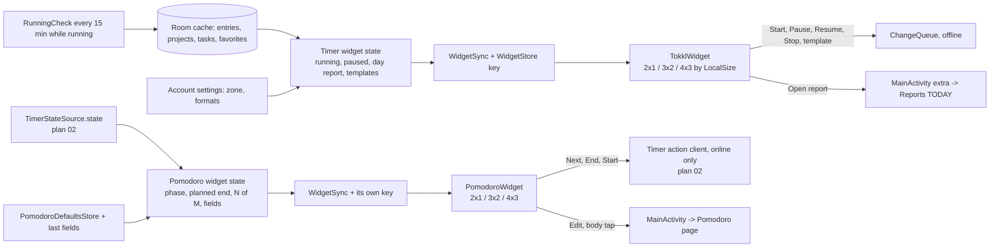
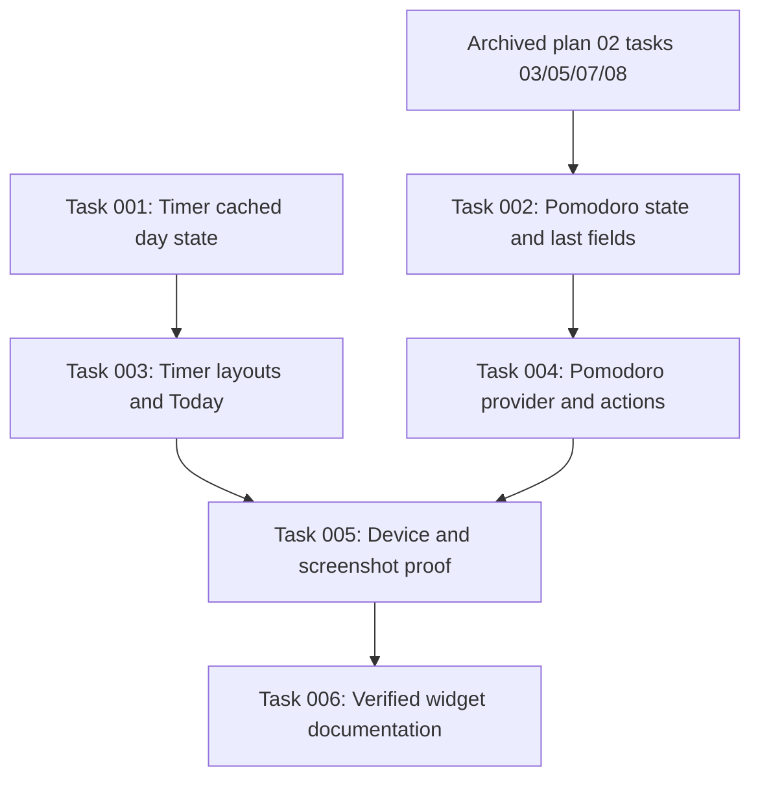

# Plan: Timer and Pomodoro home screen widgets

## Original Work Order

> The widget that goes into the home screen is very bare bones. It lists timer and is not very useful. I would like it to show the current timer and a report for the current day. Your task is to come up with realistic mock-ups for this. I'll give you a screenshot of what it looks like today. Note that I shared two different sizes of the widget. Both should work visually. We should also allow a smaller size, maybe two by one, that shows only the current timer with the project information for it.
>
> [After the Timer mockups] /st-create-plan to implement the mockups above for the homescreen widget.
>
> [At the scope gate] I also need you to mockup a second widget. This one focused on Pomodoro.

The approved mockups are in this plan's directory: [mockups/timer-widget.html](mockups/timer-widget.html) and [mockups/pomodoro-widget.html](mockups/pomodoro-widget.html). They are the visual reference for every size and state below. Each is a self-contained page drawn at one CSS pixel per dp with the tokens of `ui/theme/Color.kt`.

## Plan Clarifications

| Question | Answer |
|---|---|
| Timer templates: the current widget lists them under the timer and PRD N3 includes them. Keep them where? | As mocked. No templates at 2×1 and 3×2. A chip row of templates at 4×3 and larger, taking one project row. |
| Should the day report include billable time? | Yes, as mocked: billable seconds from the cached entries' `billable` flag, at 4×3 always and on the idle 3×2. |
| At 2×1 the mockup has one button: Stop running, Resume paused, Start idle. Pause is not reachable there. Acceptable? | Yes, one button. Pause stays in the app, the notification and the 3×2 and 4×3 widgets. |
| Backwards compatibility for placed widgets or the old favorites-rows layout? | None. The app has no users and no placed widgets. The old layout goes. |
| The day report must reset at the account's midnight, but PRD 7 promises no wakeups while no timer runs. How does it roll over? | Only while a timer runs: the existing 15-minute running check redraws the widget past midnight. Idle widgets show the previous day's total until the next cache change or app open. |
| Which session state does the Pomodoro widget read, given plan 02 moves sessions to the server? | Plan 02's server timer state, through its state holder. The Pomodoro widget waits on plan 02's action and SSE tasks. |
| What does Start on the idle Pomodoro widget do? | Starts a session on the server with the four stored defaults and the fields of the last session. Offline it fails with a short message, like every other session action. |
| One plan or two? | One plan with both widgets and the plan 02 dependency stated. |

## Executive Summary

The home screen widget today shows one line of running-entry text, a ticking clock, Pause and Stop, and as many timer template rows as fit. It says nothing about the day. This plan rebuilds it as a Timer widget with three layouts chosen by the placed size: a 2×1 strip with the project, description, clock and one button; a 3×2 card that adds a Today block with a ticking total, a stacked per-project bar and project rows; and a 4×3 card that adds Total, Billable and Entries tiles, a bar per project, an Open report link into Reports on its Today preset, and a row of template chips. Every number comes from the Room cache the widget already follows, so the widget stays offline-first and keeps its zero update period: the clocks are launcher-ticked Chronometers, the day total is a second Chronometer whose base is shifted by the day's stopped seconds, and redraws happen on cache changes and on the existing 15-minute running check.

The plan adds a second provider, a Pomodoro widget, in the launcher's picker. It renders the server's timer state from plan 02's state holder: phase, Pomodoro N of M with the cycle dots, a countdown Chronometer to `phase.planned_end` corrected by the server clock offset, a progress bar, the entry's description and chips, and Next phase and End session buttons that call the server's actions. At the planned end it shows the ended phase and overtime. Idle, it shows the four stored defaults and the last session's fields, with Start, which posts a start, and Edit, which opens the Pomodoro page. The Pomodoro widget cannot be built until plan 02's action client, SSE service and server-state rendering have landed, so this plan states that dependency and sequences the Pomodoro work behind it while the Timer widget proceeds now.

Glance with `SizeMode.Exact` already gives each placed size its own composition, and the widget state, sync and store pattern already exists. The approach extends that pattern rather than adding a new one: a richer widget state with colours and day totals, breakpoints on the placed size, and a second receiver and provider info that reuse the same sync machinery against the timer state flow.

## Context

### Current State vs Target State

| Current State | Target State | Why? |
|---|---|---|
| One widget, minimum 240×152 dp, one layout: timer row plus as many template rows as fit. | Timer widget with 2×1, 3×2 and 4×3 layouts chosen by the placed size; minimum size allows 2×1. | The owner wants a small strip for the timer alone and larger sizes that carry a day report. |
| The timer row shows description, clock, and the project name as plain text. | Project shown with its colour dot and name, task after it; description and clock sized per layout. | The project is the information the owner asked for at the small size; the colour makes it recognisable at a glance. |
| Nothing about the day. | A Today block: ticking total, stacked per-project bar, project rows with stopped time, billable and entry count at 4×3, a running marker on the running project. | The owner wants a report for the current day on the home screen. |
| Templates fill every size below the timer row. | Templates only at 4×3 and larger, as a chip row that starts the template. | The day report takes their rows at 3×2; 2×1 has no room. Owner decision. |
| The widget redraws only on cache key changes. | Same, plus the existing 15-minute running check redraws it past midnight while a timer runs. | The day total must roll over while a timer runs without adding wakeups. |
| No Pomodoro widget; the session lives in a notification and on the Pomodoro page. | A second widget provider showing the server's session: phase, countdown or overtime, cycle dots, fields, Next phase and End session, and an idle start. | The owner asked for a widget focused on Pomodoro. |
| `WidgetState.Ready` carries names only. | Widget state carries project colour, day totals per project, billable seconds, entry count and the template list; a Pomodoro widget state mirrors the server's `TimerPomodoro`. | The layouts need those values; the SHA-256 key must change when they change. |
| PRD N3 describes the widget as timer plus templates. | PRD N3 describes both widgets, their sizes and the day report; the battery row records the midnight rule. | The PRD is the source of truth for scope. |

### Background

- `app/src/main/java/com/github/e0ipso/tokkl/widget/` holds `TokklWidget` (Glance, `SizeMode.Exact`, palette through `GlanceTheme`), `WidgetState` and `widgetState(...)`, `WidgetActions`, `WidgetSync` and `WidgetStore`. `TokklApplication` builds `widgetState` from the account settings, the timer controls, cached favorites, the favorites capability, cached projects and tasks, and starts `WidgetSync`. The kenkeep node `map-home-screen-widget-cache-state-and-a-native-ticking-clock` describes this. This plan rewrites it.
- The elapsed time is a native `Chronometer` in `res/layout/widget_chronometer.xml` embedded as RemoteViews, because Glance has no chronometer. A Chronometer also counts down (`setCountDown`), which the Pomodoro widget uses for the time to the planned end; after the planned end it counts negative, so the overtime state needs a redraw, which the phase-end alarm and the state holder already produce.
- `res/xml/tokkl_widget_info.xml` sets `updatePeriodMillis` to zero, `minWidth` 240 dp, `minHeight` 168 dp, `minResizeWidth` 240 dp and `minResizeHeight` 152 dp. The screenshot's launcher gives a cell about 100 dp wide and 110 dp tall; Android's documented formula gives 2×1 at least 110×40 dp, which the 2×1 layout must survive.
- `timer/TimerTotals.kt` already computes today's seconds from cached entries in the account's zone with `AccountTime`, counting each entry once on the day of its start, and `cache/CachedRows.kt` holds `CachedProject.color` and `CachedTimeEntry.billable`. The day report reuses that rule per project rather than inventing another day boundary.
- `cache/RunningCheck.kt` runs every 15 minutes while a timer runs and writes to the cache; that write is the midnight rollover event the owner chose. This plan adds no alarm.
- `MainActivity` already takes a route from an intent extra (`ReminderNotifier.OPEN_TIMER`, the Pomodoro notification tap). `reports/ReportRange.kt` has the `TODAY` preset. The Open report link follows that pattern.
- Plan 02 (`.ai/strikethroo/plans/02--server-owned-pomodoro-and-pause-on-android/`) has landed `timerstate/TimerState.kt` with `TimerPomodoro` (`workMinutes`, `shortRestMinutes`, `longRestMinutes`, `longRestEvery`, `phase` with `kind`, `start`, `completed` and `plannedEnd`, `upcomingPhase`, `transition`, `number`, `entryId`, `pomodoroStart`) and `TimerStateSource` with a `state` flow of the held state. Its remaining tasks add the action client (task 03), the SSE service (task 05), server-state rendering (task 07) and alarms on server phases (task 08). The Pomodoro widget's countdown, actions and ringing state depend on those.
- The server state carries no session start, so the mocked "Session 1:52" line goes. "Pomodoros saved" is `number` minus one and appears only inside "Pomodoro N of M".
- Pomodoro defaults live in `pomodoro/PomodoroDefaultsStore.kt`. The last session's fields are not stored anywhere today; the idle start needs the phone to remember them.
- Palette rules from the design branch apply: Tokkl's tokens in light and dark, WCAG AA contrast, words before colour for every state, strings in resources, no wordmark. Project colours come from the server and are drawn as dots and bars, never as text colour.

## Architectural Approach

### Timer widget state and day report
**Objective**: Give the Timer widget every value the three layouts draw, from the phone alone, with a key that changes when any of them changes.

`WidgetState.Ready` grows: the running and paused entries carry the project colour; a day report carries the total stopped seconds of the account-local day, the running entry's start and accumulated seconds for the ticking total, per-project rows with name, colour and stopped seconds sorted by time, a "No project" row, billable seconds, the entry count, and the account's day label. The day report follows `timerPeriodTotals`'s rule: each entry counts once on the day of its start in the account zone, local rows win over their replaced server rows, and a running entry counts on its start day. The state function takes the cached entries of the day window the cache already holds and the account time, and `TokklApplication` wires them in next to the existing inputs. The templates stay in the state. The SHA-256 key covers all of it, so the widget redraws when a project colour, a total or the day changes.

The ticking day total is a second Chronometer whose base is now minus the day's stopped seconds minus the running entry's elapsed seconds, only when the running entry started today; otherwise it is static text. Per-project rows show stopped seconds and the running project carries a running marker in words for TalkBack and a dot in the running colour. Duration text uses the account's duration format through `AccountSettings`, with the short hours and minutes form for rows and the full form for totals, as the Reports summary does.

### Timer widget layouts by size
**Objective**: Draw the 2×1, 3×2 and 4×3 layouts of the mockup from `LocalSize`, each surviving the largest font scale and the launcher's smallest cell.

`WidgetContent` picks a layout from the placed width and height: a strip below the 3×2 threshold, a card below the 4×3 threshold, and the large card above. Thresholds are dp constants in `WidgetLayout` next to the existing row constants, derived from the provider's minimums and the cell sizes recorded in Background. The strip holds the project line with its dot, the description, the clock and one square button: Stop when running, Resume when paused, Start when idle; idle shows the day total in place of the clock. The card adds the Today block: label, ticking total, a stacked bar of project segments drawn as weighted coloured boxes, and as many legend rows as the height and font scale fit, in the same fitting style as the current favorites rows. Idle, the timer row shrinks to one line with the Start button and the billable line takes the freed row. The large card uses the taller buttons, the big clock, the Total, Billable and Entries tiles, a bar per project row, the Open report link and the template chip row at the bottom, dropping project rows before chips when the font scale leaves no room.

Every state is said in words: "No timer running", "Paused", "Today", the running marker, project and task names. Buttons keep their content descriptions. Colours come from `GlanceTheme` and the project's own colour, and the stacked bar carries a content description listing project and time so TalkBack does not depend on it. The provider info drops its minimums to allow 2×1 and keeps the zero update period. Strings go to `widget_strings.xml`.

### Open report and midnight behaviour
**Objective**: Make the day report open the matching screen and roll over on the chosen events only.

The Open report link and the Today block's tap start `MainActivity` with an extra that `MainActivity` takes the way it takes the reminder's Open timer extra, navigating to Reports and selecting the `TODAY` preset through the Reports model. Without an account the whole widget still opens sign-in. Midnight needs no new scheduling: the running check's cache write while a timer runs already changes the state key, since the day label and totals move. The idle widget keeps the previous day until the next cache change or app open, as the owner decided, and the PRD records that.

### Pomodoro widget provider and state
**Objective**: Add a second widget in the picker that shows the server's session and acts on it through plan 02's machinery.

A `PomodoroWidget`, its receiver, provider info and strings sit in the widget package beside the Timer widget. Its state derives from `TimerStateSource.state`: no account, no capability, idle, or a session with phase kind, pomodoro number, long-rest-every, the planned end, phase start, the entry fields with project name and colour, tag names and billable, and whether the phase has ended. The idle state carries the four stored defaults and the last session's fields, which the phone records whenever a session starts from any surface. A second `WidgetSync` and store key follow that flow, reusing the existing classes with their own preferences key so the two widgets redraw independently. Without the timer capability the Pomodoro widget says the server does not support sessions and opens the app.

The countdown is the native Chronometer in countdown mode from the planned end corrected by the server clock offset plan 02 computes, so the launcher ticks it without updates. At the planned end plan 02's alarm path changes the held state or ringing state, which redraws the widget into the ended-phase layout: the phase line names the finished phase, the clock counts overtime upward from the planned end, the bar is full in the running colour and Next phase is the only filled button. Next phase, End session and Start call the action client with the last seen revision; a 409 adopts the body's state, and offline the tap shows a short message, matching the other surfaces. The Pomodoro widget work starts only after plan 02's tasks 03, 05, 07 and 08 are complete and verified, and the task generation step must mark that dependency.

### Pomodoro widget layouts
**Objective**: Draw the Pomodoro mockup's 2×1, 3×2 and 4×3 layouts in the same breakpoint scheme as the Timer widget.

The strip holds the phase name in its colour, the pomodoro number on work phases, the countdown, a thin progress bar and one square Next phase button, or the defaults line and a Start button when idle. The card adds the cycle dots, big dots for work phases and small ones for rests up to the long rest, the "left of" planned length, the description with project, and the Next phase and End buttons with the transition's label from the existing strings. The large card adds the entry chips: project with dot, tags and billable, and uses the full End session label. The idle card shows the four defaults as tiles, the last fields and Start session and Edit. Work phases use the primary colour, rests the secondary, the ended phase the running colour, and every phase is named in words.

### Documentation and tests
**Objective**: Keep the PRD, kenkeep and the test suites in step with both widgets.

PRD N3 describes the Timer widget's three sizes and day report and the templates rule; a new row describes the Pomodoro widget; the battery row records the midnight rule; section 6 lists both as built when they are. This plan rewrites the widget kenkeep node and adds a node for the Pomodoro widget. `WidgetStateTest` grows for the day report and the Pomodoro state; `WidgetServerTest`, `WidgetLargeTextTest` and `NativeWidget` cover the three sizes, the ticking total, Open report, the Pomodoro actions against the pinned 1.10.0 server, and the ended-phase redraw; the commit that changes the look records the screenshot references on tokkl-api36, per the testing branch's practice. Tests must exercise the app's own behaviour and not the launcher or Glance.

## Risk Considerations and Mitigation Strategies

Technical Risks

- **Glance has no segmented bar or weighted row**: the stacked bar must be built from boxes with widths from `defaultWeight` or explicit dp, and Glance limits nesting depth and child counts.
    - **Mitigation**: Draw the bar as a Row of weighted Boxes capped at five segments, folding the rest into "Other"; prove it in `WidgetLargeTextTest` at both font scales before building the rows.
- **Countdown Chronometer past the planned end**: it shows negative time until a redraw.
    - **Mitigation**: The ended-phase redraw comes from plan 02's phase-end handling; the test asserts the widget shows the overtime layout within a second of the planned end on the emulator.
- **Launcher cell sizes vary**: the 2×1 strip may get 110×40 dp on some launchers.
    - **Mitigation**: Breakpoints pick the strip for anything below the card threshold, and the strip degrades to clock and button alone when the height drops below the two-line minimum. Verify on the AOSP launcher of tokkl-api36 and tokkl-api31.
- **Two chronometers and RemoteViews widths**: a RemoteViews child needs an explicit width, and two of them share the row.
    - **Mitigation**: Measure both with the existing Paint-based width, reserve the hours form, and keep them in separate rows at 3×2.

Implementation Risks

- **Plan 02 is mid-flight**: its action client, SSE service and state rendering are not landed, and the Pomodoro widget reads them.
    - **Mitigation**: The task blueprint orders the Pomodoro tasks after plan 02's tasks 03, 05, 07 and 08 and names them as dependencies; the Timer widget tasks run now. If plan 02 changes the state holder's shape, the Pomodoro widget state adapts in its own task.
- **Day totals diverge from the Timer page**: a second implementation of the day rule drifts.
    - **Mitigation**: Reuse `timerPeriodTotals`'s helpers, extending them with a per-project grouping rather than copying the rule; unit tests compare the widget's today total with the Timer page's for the same entries.
- **Key omissions**: a value left out of the SHA-256 key makes the widget stale.
    - **Mitigation**: The key hashes the whole state's `toString`, and a unit test changes each field and asserts a new key.

Quality Risks

- **Colour as the only signal**: project colours, phase colours and the running dot.
    - **Mitigation**: Every coloured element has a text twin or a content description; accessibility tests assert the descriptions at both font scales.
- **Screenshot drift**: new layouts change references on tokkl-api36.
    - **Mitigation**: Record references in the commit that changes the look, per the testing practice node.

## Success Criteria

### Primary Success Criteria
1. Placed at 2×1, 3×2 and 4×3 on tokkl-api36 and tokkl-api31, the Timer widget shows the layout of the mockup for running, paused and idle, with project colour, a ticking clock and a ticking day total that match the Timer page's today total for the same cache, at font scale 1.0 and the largest scale.
2. Start, Pause, Resume, Stop and template chips work offline through the queue, as today; Open report opens Reports on the Today preset; the running check past midnight moves the day report to the new day while a timer runs.
3. The Pomodoro widget appears as a second entry in the picker; with a session on the pinned server it shows phase, Pomodoro N of M, a countdown to the planned end, and after the planned end the overtime layout; Next phase, End session and Start change the server's state and the widget follows within a second; offline taps show the message.
4. Unit, Compose and instrumented suites pass on both APIs, the screenshot references for the new layouts exist on tokkl-api36, and PRD N3, the battery row and the kenkeep widget nodes describe the shipped behaviour.

## Self Validation

1. Build and install the debug app on tokkl-api36 with `scripts/instrumented-tests.sh` in the OOM-safe scope; sign in to the pinned 1.10.0 test server through `WidgetServerTest`'s helpers.
2. Through `NativeWidget`, bind the Timer widget at 2×1, 3×2 and 4×3 host sizes; seed the cache with entries today across three projects and one without a project, one running; screenshot each size and compare against the mockup's layout: project dot and name, description, clock, Today total, bar segments in project order, rows, and at 4×3 the tiles, link and chips.
3. Read the Timer page's today total through the app and assert the widget's total Chronometer base matches it to the second; advance the emulator clock past the account's midnight with a running timer, trigger `RunningCheck`, and assert the day label and totals move to the new day.
4. Tap Stop at 2×1, Pause and Resume at 3×2 and a template chip at 4×3 with the network blocked; assert the queue holds the changes and the widget reflects each within a second. Tap Open report and assert Reports opens on the Today preset.
5. Start a session on the server through the API from another credential; assert the Pomodoro widget shows the phase, Pomodoro N of M and a countdown whose base equals the planned end corrected by the offset; wait for the planned end and assert the overtime layout and the ringing state; tap Next phase and assert the server's state changed and the widget redrew. Tap Start on the idle widget and assert a session began with the stored defaults and the last fields; repeat offline and assert the message.
6. Run `WidgetStateTest`, `WidgetServerTest` and `WidgetLargeTextTest` focused on both APIs, then the full instrumented and unit suites, and record the JUnit counts. Record the screenshot references for the new layouts on tokkl-api36 and confirm the screenshot classes pass.
7. Read `docs/PRD.md` N3, the new Pomodoro widget row and the battery row, and the two kenkeep widget nodes, and confirm they describe what the tests proved.

## Documentation

- `docs/PRD.md`: rewrite N3 for the Timer widget's sizes, day report and templates rule; add the Pomodoro widget row in section 5.12 or the notifications table; update the battery row in section 7 for the midnight rule and the Pomodoro widget's online actions; update section 6's built list.
- `.ai/kenkeep/nodes/screens/map-home-screen-widget-cache-state-and-a-native-ticking-clock.md`: rewrite for the new state, breakpoints and the second Chronometer; add a node for the Pomodoro widget and its plan 02 dependency; update the screens index.
- `app/src/main/res/values/widget_strings.xml` and a new Pomodoro widget strings file: picker names and descriptions for both widgets.
- `CLAUDE.md`'s widget sentence: mention the day report and the Pomodoro widget.

## Resource Requirements

### Development Skills
- Jetpack Glance layouts with `SizeMode.Exact`, RemoteViews embedding and Chronometer modes.
- Room queries and the account-time day rule in `timer/TimerTotals.kt` and `time/AccountTime.kt`.
- Plan 02's timer state holder, action client and clock offset.
- Instrumented widget tests through `NativeWidget` and screenshot references on tokkl-api36.

### Technical Infrastructure
- The tokkl-api36 and tokkl-api31 emulators and the pinned tokkl 1.10.0 server image from `scripts/instrumented-tests.sh`, run in the OOM-safe scope.
- No new dependencies.

### External Dependencies
- Plan 02 tasks 03, 05, 07 and 08 for the Pomodoro widget's actions, state arrival, rendering rules and phase-end handling.

## Integration Strategy

The Timer widget replaces the current one in place: same package, receiver and provider name, new state and layouts. `WidgetSync` and `WidgetStore` serve both widgets with separate keys. The Pomodoro widget plugs into plan 02's `TimerStateSource` and action client without touching the Timer widget's cache path. Both widgets stay out of the server's `/me` request budget: the Timer widget reads the cache and the Pomodoro widget reads the held state, and only the Pomodoro actions and the Open report tap reach the network or the app.

## Notes

- The mockups were produced on 2026-10-28 and copied into this plan's `mockups/` directory. They are HTML for review, not Compose; dp sizes and font sizes in them are the specification for the layouts.
- The mocked 4×3 Pomodoro "Session 1:52 · 4 pomodoros saved" line is out: the server state has no session start.
- Pause at 2×1 is deliberately absent; see the clarifications.
- The Timer widget tasks have no dependency on plan 02 and may be generated and executed first.

## Execution Blueprint

**Validation Gates:**
- Reference: `.ai/strikethroo/config/hooks/POST_PHASE.md`
- Evidence: `.ai/strikethroo/config/shared/verification-gate.md`
- External prerequisite: archived plan 02 tasks 03, 05, 07 and 08 are completed. Task 2 verifies their shipped interfaces and phase-end behavior before Pomodoro implementation.
- Current PRD and completed plan 02 govern Pause/Resume: these server actions require a connection. The older offline Pause/Resume wording in this plan's success criteria is superseded; Start/Stop/templates retain their queue behavior.
- Serialize Gradle/device jobs with an agreed file lock and run each in the OOM-safe scope. No new idle wakeups or dependencies.

### Dependency Diagram

### ✅ Phase 1: Widget state and account data
**Status:** completed
**Parallel Tasks:**
- ✔️ Task 001: Extend cached Timer widget state with day totals
- ✔️ Task 002: Derive Pomodoro widget state and remember last fields

Task 1 owns Timer state and shared total helpers. Task 2 owns Pomodoro state and sync generalization. TokklApplication edits are limited to each task's respective block. Verify focused JVM tests and Android test compilation before the phase commit.

### ✅ Phase 2: Responsive providers and navigation
**Status:** completed
**Parallel Tasks:**
- ✔️ Task 003: Build Timer widget layouts and Today navigation (depends on: 001)
- ✔️ Task 004: Add Pomodoro provider layouts and server actions (depends on: 002)

Verify focused JVM/build/lint and focused device layout checks. Record API36 screenshot references before the commit changing appearance; task 5 expands behavioral proof and validates those references.

### ✅ Phase 3: Device workflow proof
**Status:** completed
**Parallel Tasks:**
- ✔️ Task 005: Prove widget workflows on API36; defer API31 to CI (depends on: 003, 004)

Inventory and isolate all failing tests, then run full local suites on API36 and record JUnit counts and all seven Self Validation steps. API31 remains deferred to the existing CI matrix under the user's explicit scope override.

### Phase 4: Documentation of verified behavior
**Status:** pending
**Parallel Tasks:**
- Task 006: Document verified Timer and Pomodoro widgets (depends on: 005)

### Post-phase Actions

Apply POST_PHASE after each verified phase, create its Conventional Commit and mark the phase/tasks completed. After phase 4 run POST_EXECUTION in full, then the code review gate exactly once, append its verbatim result and the execution summary, and archive only when all gates permit it.

### Execution Summary
- Total Phases: 4
- Total Tasks: 6

## Phase 1 verification

Parent verification on 2026-10-29 ran `:app:testDebugUnitTest` for `widget.*`, `pomodoro.*` and `timer.TimerTotalsTest`, plus `:app:compileDebugAndroidTestKotlin :app:lintDebug`, with `./gradlew --no-daemon` in the OOM-safe scope under `/tmp/tokkl-plan3-gradle.lock`. Exit 0, BUILD SUCCESSFUL; 154 tests, zero failures/errors/skips. Android test compilation and lint passed. Log: `evidence/phase1/parent-combined-check.log`; per-suite JUnit: `evidence/phase1/combined-junit/`. `git diff --check` passed. Parent read the state, total-helper, sync and account-lifecycle changes before accepting the phase.

The plan's assumed Room write on every RunningCheck is not guaranteed: an equal current row is suppressed. The widget observes existing WorkManager state events as well as cache/app-open events to redraw the day without adding work or idle wakeups.

## Phase 2 parent verification

The first combined API36 widget package run returned exit 1: 24 tests, 2 failures, 0 errors/skips. Complete inventory: `evidence/phase2/parent/failure-inventory.txt`; JUnit: `evidence/phase2/parent/api36-results/`. Both rendering matrices and native clocks passed. The failures were the retired combined Pause text assertion and an immediate Pomodoro heading assertion that did not wait for asynchronous stored-session routing.

The exact two-method focused reproduction (`focused-before`) ran 2 tests with 1 failure, confirming the stale Pause expectation; the navigation timing failure did not recur in that selection. The parent changed the Pause assertion to check the new paused header and separate clock, and made navigation wait on its page heading before checking display. `focused-after` then returned 0: 2 tests, 0 failures/errors/skips. Assertions of server state, captured revisions and navigation fallback remain in place. Full widget package validation follows before phase completion.

One earlier `focused-after` attempt was interrupted at the turn boundary before results. Its remaining adb server inherited the build lock. Read-only process inspection identified that exact owned server, with no test process remaining; stopping it released the lock. The attempt is preserved under `focused-after-interrupted` and supplies no passing evidence. Later tests run on the Device panel emulator via the maintained project runner.

Parent JVM/lint verification returned 0: 81 selected tests, no failures/errors/skips, Android test Kotlin compilation successful, lint 0 errors/fatal issues with 15 warnings. Evidence: `evidence/phase2/parent/jvm-results/`, `jvm-lint.log`, `lint.xml`.

## Previous execution attempt

**Status**: Halted in phase 2; not archived
**Completed Date**: Not completed; halted on 2026-10-30

### Results

Phase 1 is verified and committed as `a27d347991109e6094963288b070d641d929a1dc`. Tasks 3 and 4 supplied both providers, three layouts, navigation, guarded online session actions and 208 reference images. Their work remains uncommitted pending parent phase verification. Parent JVM selection passed 81 tests with no failures/errors/skips, Android test compilation succeeded, and lint has no errors. Parent found and corrected two test issues; the exact two-method focused rerun passed 2/2. Phase 2 has not passed its final integrated device gate. Tasks 5 and 6, POST_EXECUTION, code review and archival have not run.

**Code Review**: Failed — Review was not run: phase 2 device verification halted because device support repeatedly failed after refresh.

### Noteworthy Events

- The first combined API36 package produced 24 tests with 2 failures. Both screenshot matrices and native clock tests passed. The parent isolated the failure set, corrected the retired Pause-text expectation and the navigation assertion's missing asynchronous wait, and verified 2 focused tests passed. Full evidence and failure inventory are under `evidence/phase2/parent`.
- The final widget-package rerun lost reliable device connectivity. The device tool reported exactly `Device list failed: Could not communicate with device support. Try refreshing devices.` An initial refresh recovered, but the later screenshot operation failed with `Device screenshot failed: Could not communicate with device support. Try refreshing devices.` Its advised refresh and screenshot retry both failed with the same communication error. The current device-tool instructions require stopping after that failed retry, without bypassing the tools. This is an infrastructure halt, not a clean device-test result.
- The parent requested shutdown of only its own active test scope, `run-r85fd913d0ea1451ba7fd414354b11d97.scope`, after deciding to halt. The incomplete `api36-final` run supplies no success evidence. The Device panel emulator remains managed by the device tools; no adb/SSH fallback was used to control or shut it down.
- Review gate JSON: no result was produced because the gate was not reached. Findings acted on: the two parent-observed test issues above. No review findings were ignored because code review did not run.
- Kenkeep lint and freshness ran again, returning 0 with existing orphan/redirected-edge findings and 28 stale nodes. Curation is still pending; widget knowledge updates belong to task 6.

### Necessary follow-ups

Restore local Device panel/device-support connectivity. Resume plan 3 at the final phase 2 package check, inspecting any unfinished runner reports before retrying. Once phase 2 is verified, commit it with its references, execute task 5's API31/API36 real-server and complete-suite acceptance plus dead-layout cleanup, then task 6 documentation. Run POST_EXECUTION and the code review gate once before summary and archival. Do not rerun branch creation or base capture; both already ran once. No push or PR has been authorized by the plan hooks.

## Resume and acceptance scope — 2026-10-30

The user directed: "address the issues and try device acceptance again. We only test for API36 locally, and defer 31 for CI." This overrides the plan's local two-API run requirements: all local device acceptance runs use tokkl-api36; API31 remains supported and is deferred to CI. No API31 local run is required for local completion or archival, and no passing API31 result is claimed.

The advisory Opus 5.5 review identified the denied-alarm phase-end update, stale phase progress/percentage, static running Billable tile and retired layout helpers/strings. The implementer addresses these within task 5. The progress display becomes a phase-colour band with words, avoiding a falsely current percentage without periodic widget wakeups. Billable uses a native clock while a billable segment runs.

Phase 2 is accepted from the initial parent's 24-method device run (22 passed, all 208 references and native clocks passed), the corrected 2/2 focused run, and exact content verification now. `evidence/phase2/parent/resume-input-audit.json` compares 85 Timer inputs and 180 Pomodoro inputs with the recorded successful manifests. The only mismatches are precisely WidgetNavigationTest.kt and WidgetServerTest.kt, whose two failures were fixed and passed in the focused rerun. Production code and reference images match the previously tested inputs. The unfinished full rerun remains excluded. Phase 2 is committed before review fixes change appearance; task 5 records references for those further changes in its own commit.

### Review fix implementation

Parent implemented all four advisory fixes; see `evidence/phase3/review-fixes/README.md`. Focused verification passed 70 tests with no failures/errors/skips, Android test compilation and lint with zero errors. Native acceptance and updated visual references remain with task 5. Inexact fallback delivery is best effort; exact-alarm denial remains visible, and no new idle work or periodic widget redraw is added. API31 is deferred to CI.

## Execution Summary — second device acceptance attempt

**Status**: Halted in phase 3; not archived
**Completed Date**: Not completed; attempt halted on 2026-10-30

### Results

Phase 2 is committed as `cf0af4a`. All four advisory findings have implementation fixes, and task 5 added real-server Pomodoro native-action/account/defaults/offline/conflict/live-deadline tests, denied-alarm native scheduling tests, the Billable clock test and real-worker midnight coverage with a narrow default-UTC Clock seam. These changes remain uncommitted because the required refreshed appearance references and device acceptance have not completed.

The parent independently parsed the saved JUnit and npm output, checked exit codes/build/lint receipts, and compared all 1,006 recorded input hashes with the current tree: 1,069 JVM tests with 0 failures/errors/skips, 10 npm tests passed, Android test compilation successful, lint 0 errors/fatal issues. Receipt: `evidence/phase3/parent-host-audit.json`. No device acceptance is inferred from those host results. Task 5 is failed/incomplete; task 6 remains pending.

**Code Review**: Failed — terminal review was not run because task 5's API36 runtime/visual acceptance remains incomplete. The separate advisory Opus 5.5 review ran, and its four findings have been addressed in code; runtime proof remains pending.

### Noteworthy Events

- Device panel attached to the runner's bounded lavapipe/read-only API36 instance. Its screenshot operation failed with `Device screenshot failed: Could not communicate with device support. Try refreshing devices.` The advised refresh succeeded, but the one screenshot retry failed with the same error. The tool instructions require stopping device work after that retry. The worker stopped only its own run scope and emulator; the parent verified the owned run scope is inactive/dead. The device run exited 143, has no terminal JUnit or complete liveness receipt, and supplies no accepted runtime result.
- Before interruption, two fixture failures were observed and corrected, without weakening their account/revision assertions. They still need a focused rerun. Exact selectors and observed events are saved in `evidence/phase3/task5/known-failure-selectors.txt` and the initial-run directory. The missing terminal report is not represented as a complete failure inventory.
- Changed phase-band and running-Billable references remain unrecorded/unreviewed. The phase cannot be committed as visually verified. Seven Self Validation steps and all plan success criteria have an explicit evidence/gap map in `evidence/phase3/task5/README.md`.
- API31 was not booted or run locally. It remains deferred to the existing CI [36,31] matrix per the user override; no passing API31 result is claimed.
- Review gate JSON: no result produced; the gate was not reached. The advisory review's four findings were acted on; none were ignored. The terminal review remains pending after POST_EXECUTION.

### Necessary follow-ups

User direction is required under the execute-blueprint failure rule before continuing the failed phase. Diagnose/restore Device panel screenshot support, or explicitly change the remaining acceptance workflow. Once device support is available, run the two corrected fixture selectors first, then finish native/alarm/midnight runtime proof, review only changed references, and run the required final API36 instrumented/Compose suite. Complete task 6 and final gates only with accurate verification claims. No API31 local run, push or PR is implied by this halted attempt.

### Device-support diagnosis follow-up — 2026-10-30

The user selected diagnosis. The Device hub returns gRPC status 16, missing authorization credentials: it cannot find the authenticated emulator discovery record inside the runner's isolated runtime directory. Discovery itself works. [Diagnosis and scoped repair design](evidence/phase3/device-support-diagnosis.md) records the source/runtime evidence and a proposed ownership-safe discovery link; no repair or successful screenshot is claimed. No global service restart or authentication bypass was attempted.

The completed API36 focused run executed both known failure selectors, with two failures and unchanged inputs. Replacement-account setup throws a null-value error; native widget cleanup still sees one widget. These results replace the previous “corrected but not rerun” status. The runner naturally cleaned up its emulator, the owned scope is inactive/dead, and this thread's Device panel attachment was closed. No reference changes, acceptance, commit or push occurred. Phase 3 remains halted pending user direction, with API31 deferred to CI.

### Resumed phase 3 validation strategy

After the user authorized repair and renewed acceptance, authenticated discovery and Device panel capture recovered. The original two failing selectors passed. All 208 widget references were exercised and 40 changed captures were visually reviewed and replaced. The first complete API36 suite ran 736 cases: all 33 widget cases passed, while ten broader test failures were isolated. Four counted independent Glance jobs as Tokkl work; six used the nonvisual automation IME retained by the AVD. A positive union of Tokkl Worker tags and runner-owned stock-keyboard setup fixed all ten without changing the original keyboard test files. Exact ten-case and surrounding 41-case runs passed with unchanged inputs.

The next unfiltered run was interrupted by QEMU's hang detector under actual shared-host memory pressure: 535 cases passed, one was unfinished, 200 did not execute. It supplies no full-suite acceptance. Competing processes were not terminated. Host checks continue independently in the required protected scope.

The next complete local API36 validation uses the existing CI configuration: six sequential invocations of the maintained runner with `numShards=6` and `shardIndex=0..5`, one fresh bounded emulator per invocation. The shipped `StepAwareShardingFilter` keeps ordered restart-test classes together. Each invocation runs its whole shard; no custom class batching, source change, skipped test or API31 local run is introduced. Acceptance requires all six terminal runs to pass on matching source/resource/build/runner inputs, with an exact disjoint union of the original 736 case identities, all 33 widget methods and all eight reference classes. The interrupted 535-case subset is not substituted for any shard. API31 remains deferred to CI.

### Phase 3 parent acceptance

The six final API36 shards passed 134/108/108/132/127/127 cases. The parent independently parsed all terminal XML, required zero failures/errors/skips, compared the exact 736 identities with the complete inventory, checked all 33 widget methods and eight reference classes, and verified all 1,011 current input hashes against every accepted run. Receipt: `evidence/phase3/task5/parent-shard-xml-audit.json`. The worker's independent union audit additionally proves all eight ordered restart groups stayed whole, all 736 actual start/finish receipts match, and six distinct owned boots were used. All 208 widget reference comparisons passed; 40 changed captures were reviewed and copied, with 168 preserved.

Fresh host verification passed 1,069 JVM tests with zero failures/errors/skips, executed Android test compilation, and produced lint with zero Error/Fatal issues (12 warnings and one hint). All 11 npm tests passed, including the five-case Python lifecycle suite wrapper. The parent checked saved XML/exit codes/npm counts and fresh `git diff --check`. Accepted source/resource/build/runner/npm manifests match the current tree. All owned final units are inactive and the Device panel is closed. Task 5 is completed within the explicit API36 local/API31 CI scope. Task 6 still owns the documentation updates and final Self Validation 7 doc-match; whole-plan completion and the terminal review gate are not yet claimed.
