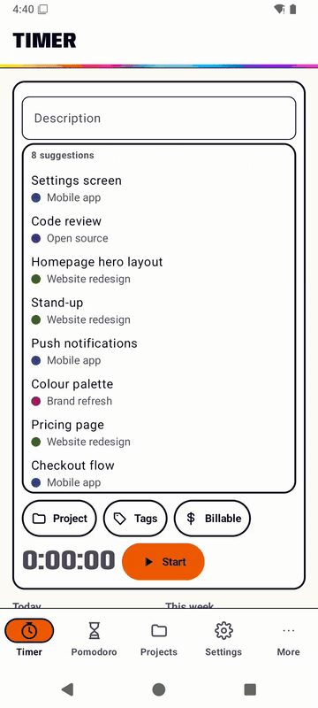
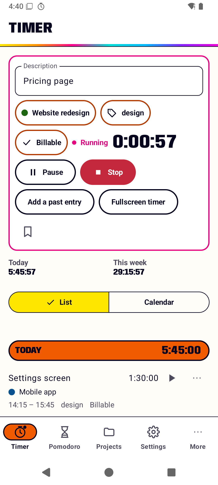
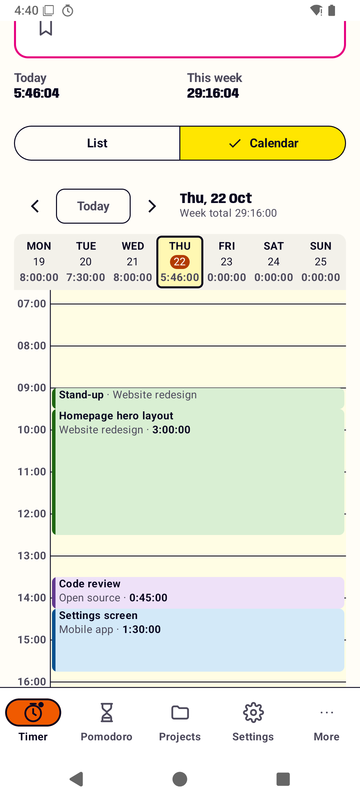
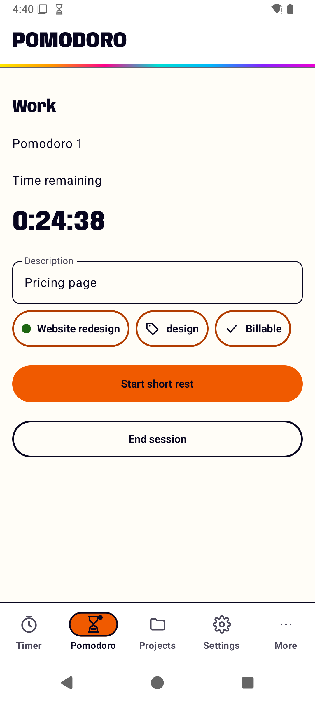
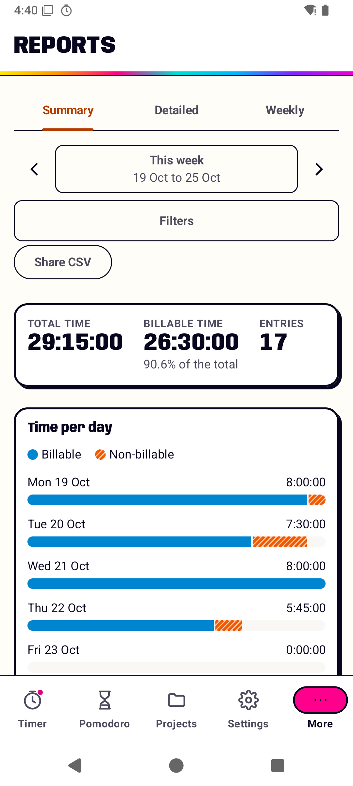

<h1></h1>

Track time on your phone against your own [Tokkl](https://github.com/e0ipso/tokkl) server. Tokkl is a self-hosted time tracker modeled on Toggl Track. This is its Android app.

## Install

Download the APK from the [latest release](https://github.com/e0ipso/tokkl-android/releases/latest). It needs Android 12 or later and an account on a Tokkl server. Sign in with the server's URL and your API token, or your email and password.

## What it does

- **Timer.** Start a new entry or continue a recent one, then pause or stop it. Control the running timer from its notification, a home screen widget or a Quick Settings tile.
- **Works offline.** Start, stop and edit with no connection. The phone queues your changes and sends them in order when the network returns.
- **History.** Past entries by day, grouped like the web app, or on a week calendar. Add, edit, split or duplicate an entry. Deleting one offers Undo.
- **Pomodoro.** Work and rest phases with an alarm at the end of each, over the lock screen if you allow it.
- **Reports.** Summary, detailed and weekly reports with the web app's filters, exportable as CSV.
- **Manage.** Projects, tasks, clients and tags. Restore deleted entries from Trash.
- **Private.** No ads, analytics or tracking. The app talks only to your server, and signing out deletes your data from the phone.

  
  
  
  

## Development

Build, test and release notes live in the [kenkeep knowledge base](.ai/kenkeep/ENTRY.md), under `build-and-tooling`, `testing` and `release`. Scope and decisions are in [docs/PRD.md](docs/PRD.md).

## License

MIT. See [LICENSE](LICENSE).
